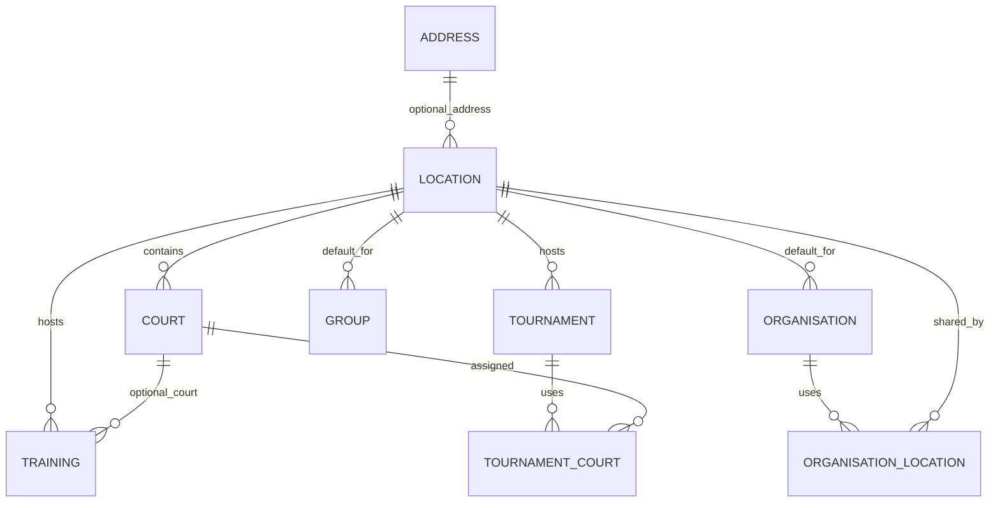

# Beach Volleyball Hub — Location, Organisation, Court & Google Maps Implementation Plan (v2)

**Date:** 21 October 2026  
**Status:** Proposed, pending repository audit  
**Source plan:** [Existing October 8 plan](https://github.com/romalopes/beachvolleyballhub_api/blob/main/docs/FUTURE/Location/BVP_Location_Implementation_Plan.md)  
**Backend:** https://github.com/romalopes/beachvolleyballhub_api  
**Frontend:** https://github.com/romalopes/beachvolleyballhub_frontend  
**Suggested repository path:** `docs/FUTURE/Location/BVP_Location_Implementation_Plan.md`

> This is an extension of the existing plan, not a replacement of its safety requirements. The linked document already includes `Organisation.default_location_id`, `Group.default_location_id`, `Training.location_id`, `Tournament.location_id`, location aliases, geocoding, deduplication, migration and curation. This revision makes Organisation-facing UI, Google Maps and structured Courts first-class deliverables. The codebase was not directly audited; all names and existing schema details must be verified in Phase 0.

## 1. Product goals

1. Maintain one canonical, reusable catalog of physical venues (beaches, indoor venues, parks, clubs).
2. Allow an Organisation to set a default venue and optionally associate additional venues it commonly uses.
3. Allow a Group, including an independent Group, to choose its own default venue or inherit a suggestion from its Organisation.
4. Assign a persisted venue to each Training Session and Tournament, independent of later default changes.
5. Support an optional named Court within a venue, with its own optional coordinates and access instructions.
6. Show venue and court information with a Google Maps interface on Organisation, Training Session and Tournament pages; also consider Group details.
7. Import a curated set of verified Sydney beach volleyball venues, with idempotent seeds.
8. Support location proposals, curator verification, safe merging, archived historical references and organization-aware authorization.

### Non-goals for first release

- Court booking/availability or court conflict resolution.
- Match-level court scheduling, tournament brackets or live court assignments.
- Multi-venue tournaments (can be added later without redesigning canonical Location).
- Public location tracking or mandatory browser geolocation.
- Automated nationwide scraping or importing guessed coordinates.

## 2. Domain model and relationship choices



**Audit actual model names:** `Organisation` versus `Organization`; `Training` versus `TrainingSession`; `Account` versus legacy `User`; Group ownership/inheritance; existing Address/Location implementation. The diagram is conceptual.

### 2.1 Shared locations vs organisation ownership

**Recommended:** `Location` is a shared catalog record, not owned by an Organisation. Several organisations can use the same beach. A location's `created_by` or `proposed_by` records provenance, **not exclusive ownership**. Authorisation to manage an Organisation's venue associations is separate from authorisation to edit the canonical Location.

**Organisation.default_location_id** is a nullable FK to `locations`. If an Organisation needs a list of commonly used venues, add `OrganisationLocation(organisation_id, location_id, created_by_id, timestamps)` with a unique `(organisation_id, location_id)` index. Consider a `notes` field only if organization-specific instructions are genuinely required. The default venue must be in the associated venue list if the list is enabled; enforce consistency via a service/transaction. Do not add both a join-row `is_default` flag and `default_location_id` as competing sources of truth.

**Group.default_location_id** is nullable; independent groups can set it directly. A group under an Organisation can override the Organisation default. Avoid materializing inherited values on the Group itself.

**Decision gate:** If existing Organisation semantics only require one default, defer `OrganisationLocation` to a second increment. This plan covers the optional multi-venue feature without making it mandatory.

### 2.2 Location schema

| Column | Type | Purpose |
|---|---|---|
| `name` | string required | Canonical display name |
| `normalized_name` | string required | Dedup/search key |
| `location_type` | string enum | beach, sports_venue, park, indoor, other |
| `address_id` | nullable FK | Reuse existing Address where appropriate |
| `formatted_address` | string nullable | Display text, subject to provider terms |
| `latitude`, `longitude` | decimal(10,7) nullable | Venue point, together or neither |
| `timezone` | string | IANA timezone, e.g. Australia/Sydney |
| `description`, `notes` | text | Public details vs internal notes |
| `access_instructions` | text nullable | Persistent venue directions |
| `geocoding_provider`, `provider_place_id` | strings nullable | Provenance, terms-dependent |
| `geocoding_status`, `geocoded_at` | status, datetime | Job state |
| `coordinate_source` | string nullable | manual, seed, geocoder |
| `verified_at`, `verified_by_id` | datetime, FK | Curator verification |
| `created_by_id` | FK nullable | Actor provenance, confirm Account model |
| `active` | boolean | Archive instead of delete |
| `merged_into_id` | nullable self-FK | Optional merge tombstone |
| timestamps | datetime | Audit |

Retain `LocationAlias(location_id, name, normalized_name)` from the original plan. Coordinate constraints: latitude -90..90, longitude -180..180, both null or both non-null. Index FK fields and canonical names with locality context. A proximity match (e.g. 200m) generates a **review suggestion**, never an automatic merge. Never globally unique-index a beach name without locality.

### 2.3 Court schema

| Column | Type | Purpose |
|---|---|---|
| `location_id` | required FK | Parent venue |
| `name`, `normalized_name` | strings | Court 1, Court 2, North Court |
| `latitude`, `longitude` | decimal(10,7) nullable | Exact court point, optional |
| `description`, `access_instructions` | text nullable | Stable court-specific instructions |
| `surface_type` | string nullable | sand, indoor, grass, other |
| `active` | boolean default true | Archive, retain historical references |
| timestamps | datetime | Standard |

Unique `(location_id, normalized_name)`; coordinate pair/range constraints. No need to create Court records for every beach in initial seeds: unverified courts remain unspecified. A court's GPS overrides the venue point for navigation only when both coordinates are present.

### 2.4 Event schema and behavior

- `Training.location_id` nullable initially, `Training.court_id` nullable; `Training.location_detail` optional free text for one-off directions.
- `Tournament.location_id` nullable initially, `Tournament.location_detail` optional free text; `TournamentCourt(tournament_id, court_id)` optional join for multiple courts within its single venue.
- Validate a Training court belongs to its Training location; all Tournament courts belong to its Tournament location.
- If the current tournament workflow does not yet need multiple courts, ship the join model behind a simple UI and defer match allocation.
- Historical events retain their persisted location even if an Organisation or Group default changes.
- If the venue changes, clear or explicitly revalidate selected court(s).
- Do not confuse reusable court instructions with event-specific meeting notes.

## 3. Default resolution and Organisation behavior

For **new Training Sessions**:

1. Explicit user-selected location wins.
2. Group's own default, if set.
3. Group's parent Organisation default, if applicable.
4. Direct Training Organisation default, if applicable.
5. Otherwise leave blank and prompt the editor.

For **new Tournaments**, prefer explicit selection; otherwise prefill from the organising Group/Organisation using the same precedence. The frontend may display a suggested default, but the backend must persist the chosen `location_id` when the event is created. Changing defaults never silently updates future or historical persisted events.

For **Organisation editing**:

- Admin or an authorized organisation manager selects a default from approved active locations.
- Optionally manage a set of additional associated locations; the same Location can belong to multiple organisations' lists.
- Display default and additional locations on Organisation details, with map markers and a clear primary/default label.
- Archive/removal of an association must not delete the Location or alter existing events.
- Changing the default should not silently alter Group overrides or event locations.
- If the default is archived, keep historical references, warn admins, and require a replacement for new events when appropriate.

For **Group editing**, expose an explicit “Use Organisation default” option versus an independently selected venue. Independent Groups have no parent default.

## 4. Google Maps and geocoding strategy

**Separate four responsibilities:** (a) canonical venue data in PostgreSQL, (b) background geocoding/curation, (c) location selection against the application's own API, (d) map display/navigation.

- Render reusable `LocationMap` in Organisation, Training and Tournament details; optionally Group details.
- Show a venue marker, plus court marker(s) where precise coordinates exist; center/fit bounds appropriately.
- Provide a direct “Open in Google Maps” navigation link. URL-encode coordinates/place data safely.
- Forms use `LocationSelector` searching your own `/locations` API, not a geocoder on every keystroke.
- Add a curator-only map editor for manual pin confirmation; do not overwrite verified manual coordinates from later geocoding jobs.
- Consider Google Maps JavaScript API for interactive views and Google Places Autocomplete only if approved and appropriately billed; use lazy loading to reduce cost.
- Keep browser keys restricted by website referrer and API; keep server secrets server-side. Cloudflare Pages Vite variables are public at build time; do not put privileged secrets in `VITE_*`.
- Provide graceful fallback (venue text + external Google Maps link) when maps fail or keys are missing.
- Respect Google Maps/Places license, caching, attribution, map display and storage restrictions. Review current pricing/quotas and configure alerts before rollout.
- For geocoding, preserve the original plan's asynchronous Geocoder adapter and rate limiting. If using public Nominatim, no public-endpoint autocomplete, proper identification, caching and usage limits; confirm current provider policy.
- Do not geocode in Rails validations, migrations, CI, seeds or synchronous event creation.

## 5. API contracts (illustrative; adapt to existing routes)

```http
GET    /api/v1/locations?q=coogee&active=true
GET    /api/v1/locations/:id
GET    /api/v1/locations/:id/courts
POST   /api/v1/locations                  # proposal
PATCH  /api/v1/locations/:id              # authorised edit
POST   /api/v1/locations/:id/verify       # curator/admin
POST   /api/v1/locations/:id/archive      # curator/admin
GET    /api/v1/locations/:id/duplicates   # curator/admin
POST   /api/v1/locations/:id/merge        # curator/admin
POST   /api/v1/locations/:id/geocode      # authorised retry
POST   /api/v1/locations/:id/courts       # authorised curator
PATCH  /api/v1/courts/:id                 # authorised curator
GET    /api/v1/organisations/:id/locations
POST   /api/v1/organisations/:id/locations  # optional associations
DELETE /api/v1/organisations/:id/locations/:location_id
PATCH  /api/v1/organisations/:id           # default_location_id
PATCH  /api/v1/groups/:id                  # default_location_id
```

Return event location summary and optional court(s) in existing event serializers. Include location name, coordinates (if permitted), address, timezone and safe public instructions. Never leak internal curator notes, hidden events or restricted Organisation membership through venue search. Paginate and throttle search endpoints.

## 6. Permissions

| Capability | Guest/member | Coach/event editor | Organisation manager | Curator/admin |
|---|---|---|---|---|
| View approved venues | According to event visibility | Yes | Yes | Yes |
| Choose location for own event | No unless editor | Yes | If event editor | Yes |
| Propose location | Product decision | Yes | Yes | Yes |
| Edit Organisation default/associations | No | Only if authorised manager | Yes | Subject to scope |
| Edit Group default | No | Only if group manager | If authorized | Yes |
| Create/modify canonical Courts | No | Proposal only | Proposal only | Yes |
| Verify coordinates / merge / archive | No | No | No by default | Yes |

Map these capabilities to **existing** RBAC roles/permissions. No new hard-coded role checks. Prevent cross-organisation edits, forged approval states, and assignment of courts from a different location. A public Location does not make private Training Sessions public.

## 7. Delivery phases and AI coding prompts

**Execution rule for every prompt:** inspect current files first, list impacted files and assumptions, write tests, make focused changes, run available checks, report exact commands/results, and do not deploy or delete data without approval. Prefer small pull requests per phase.

### Phase 0 — Repository and schema audit (mandatory)

**Deliverables:** `docs/location/00-current-state.md`, actual ERD, migration inventory, existing route/component map, model naming decisions, permissions matrix, decision on multi-venue Organisation associations.

**AI prompt:**

```text
Inspect the current Beach Volleyball Hub Rails API and React/Vite frontend repositories before changing code. Compare the existing docs/FUTURE/Location/BVP_Location_Implementation_Plan.md with the actual schema and source. Identify exact models, associations, migrations, serializers, endpoints, policies, RBAC, tests and UI components for Address, Organisation, Group, Training/TrainingSession and Tournament. Check whether Location/Court or any default_location_id fields already exist. Find current address/free-text court fields and historical records. Verify Account versus User actor references. Recommend minimal compatible changes, including Organisation default and optional OrganisationLocation association, structured Courts and Google Maps. Produce docs/location/00-current-state.md, file inventory, data mapping, risks and unresolved decisions. Do not edit application code.
```

**Gate:** approve actual names, Address reuse, default semantics, multi-venue need, auth model, provider choice.

### Phase 1 — Core Location domain and safe migrations

**Deliverables:** Location, LocationAlias, associations, indexes/checks, factories/model tests; nullable Organisation/Group/Event location references.

**AI prompt:**

```text
Using the approved Phase 0 audit, implement or adapt the canonical Location and LocationAlias models. Preserve the existing plan's geocoding provenance, verification, normalized aliases, archival and optional merge tombstone. Reuse Address where compatible. Add nullable Organisation.default_location_id, Group.default_location_id, Training.location_id and Tournament.location_id and optional event location_detail. Use the actual model names and Account identity conventions. Add paired coordinate checks, range checks, indexes, safe foreign keys and association validations. Do not drop legacy fields or backfill by guessing. Add model and migration tests; document rollback. Keep existing API behavior working.
```

**Gate:** safe migrate/rollback on disposable copy, tests green, no destructive migration.

### Phase 2 — Organisation and Group location associations

**Deliverables:** Organisation default location, Group override/inheritance, optional OrganisationLocation join, authorization and tests.

**AI prompt:**

```text
Implement Organisation default-location management and Group default-location override using existing RBAC and tenancy boundaries. If the approved Phase 0 decision enables multiple Organisation venues, create OrganisationLocation with a unique composite index, a single canonical default_location_id on Organisation, and transactional consistency between default and associated venues. Multiple organisations must be able to associate the same Location. Independent Groups may set their own default; dependent Groups inherit only as a suggestion. Changing a default must not rewrite event locations. Add request/model tests for permissions, inheritance, removal, archival and cross-organisation access.
```

**Gate:** organisation A and B can share Coogee Beach; default changes leave events unchanged.

### Phase 3 — Structured Courts and event links

**Deliverables:** Court model, Training optional court, TournamentCourt join, validation and serializer changes.

**AI prompt:**

```text
Implement Court as a child of Location with name, normalized_name, optional exact coordinates, descriptions, access instructions, surface_type and active flag. Add unique (location_id, normalized_name), coordinate constraints and archival behavior. Add optional Training.court_id and optional TournamentCourt join for multiple courts within the tournament's one location. Preserve location_detail for event-specific instructions. Validate court belongs to the event's location and clear/reject stale court selections when location changes. Update API serializers and strong parameters. Add request/model tests and preserve historical data. Do not implement match-level scheduling or bookings.
```

**Gate:** selecting Court 1 at Coogee works; selecting a Bondi court for a Coogee event fails.

### Phase 4 — Geocoding, curation and duplicate detection

**Deliverables:** asynchronous geocoding service/job, manual pin verification, duplicate suggestions, merge service, tests.

**AI prompt:**

```text
Adapt the existing location plan's Rails Geocoder architecture: explicit asynchronous jobs, configurable provider, request identification, caching, global rate limits, retries/backoff, stale-job protection and no network calls in validation/migrations/seeds. Never overwrite verified manual coordinates. Build duplicate suggestions using normalized name, aliases, locality and proximity (about 200m review radius, not automatic identity). Add curator verification and a transaction-safe merge service that repoints Organisation.default_location_id, Group.default_location_id, OrganisationLocation, Training.location_id, Tournament.location_id, and all other actual references. Preserve Court associations carefully: never silently merge different courts or leave invalid event court references. Retain tombstones, audit changes and test rollback/concurrency.
```

**Gate:** verified pins stay intact; merge retains organisation associations and event history.

### Phase 5 — Curated Sydney beach seed import

**Deliverables:** verified seed dataset, provenance, import task, dry-run and tests.

**AI prompt:**

```text
Build an idempotent seed/import for candidate Sydney venues: Coogee, Maroubra, Bondi, Bronte, Clovelly, Tamarama, Manly, Freshwater, Dee Why, Narrabeen, Cronulla and Brighton-Le-Sands, expanding only after verification. Confirm that each is a valid volleyball venue or label it as an unverified candidate; verify coordinates against reliable permitted sources and record provenance/date. Do not invent court counts or exact court GPS. Do not geocode during seed runs, tests or CI. Match by stable seed identifier or scoped canonical identity, preserve existing verified/manual coordinates, log duplicates/unverified records, and prove running seeds twice adds no duplicates.
```

**Gate:** source-reviewed data only; no external calls during import.

### Phase 6 — Location and Court API

**Deliverables:** scoped endpoints, search, CRUD/proposals, pagination, request specs, API docs.

**AI prompt:**

```text
Implement Location and Court API endpoints following the project's actual Rails routes/controllers/serializer conventions. Add search by canonical name, aliases and locality; optional approved/active filters; venue detail with courts; authorized proposals; curator verification, archive and merge operations; and Organisation location association endpoints if enabled. Include location and court summaries in Training/Tournament and Organisation/Group responses. Apply existing RBAC/tenant scoping, strong parameters, pagination, throttling and error contracts. Prevent unauthorized modification of verification/approval state and disclosure of private events. Add complete request tests and OpenAPI/docs if present.
```

**Gate:** search works for seeded Coogee; unauthorized mutations are rejected.

### Phase 7 — Organisation and Group frontend

**Deliverables:** reusable LocationSelector, Organisation default/list UI, Group override UI, tests.

**AI prompt:**

```text
Inspect current React/Vite Organisation and Group details/edit pages, hooks, API clients, form validation and design system. Build reusable accessible LocationSelector and optional CourtSelector using the application's own API. Add Organisation default location picker, optional commonly-used venue list and details section; clearly distinguish default from additional venues. Add Group 'Use Organisation default' versus 'Override location' controls and support independent Groups. Show address, coordinates/verification status and graceful empty states. Respect existing permissions, do not show unauthorized edit actions, and add component/integration tests. Avoid unnecessary UI libraries.
```

**Gate:** editing a Group override does not change Organisation default; both pages show correct venue.

### Phase 8 — Training and Tournament frontend

**Deliverables:** event location/court selectors, details, validation, tests.

**AI prompt:**

```text
Inspect actual Training and Tournament create/edit/detail flows. Add LocationSelector with a prefilled Group/Organisation default, always editable by authorized event editors. Add CourtSelector filtered to the chosen Location for Training, optional multi-court selector for Tournament, and a separate event-specific location_detail input. Persist the selected location on event creation; do not dynamically recompute it on reads. Clear/revalidate courts when location changes. Show venue, address, court(s), instructions and map placeholder on details pages. Maintain backwards compatibility for old events with missing locations. Add component and E2E tests.
```

**Gate:** old events still render; default changes do not rewrite created events.

### Phase 9 — Google Maps integration

**Deliverables:** LocationMap, marker/fit bounds, navigation links, curator pin editor, documentation, tests.

**AI prompt:**

```text
Implement a reusable lazy-loaded Google Maps LocationMap for Organisation, Training and Tournament details (and Group details if already supported). Render a venue marker and precise Court marker(s) when coordinates exist; fit bounds and label markers clearly. Add an Open in Google Maps navigation link and text-only fallback if maps fail, are blocked or lack an API key. Add a curator-only map pin editor with explicit save/verify, never automatic overwriting of manually verified coordinates. Use referrer-restricted browser API keys, document Cloudflare Pages environment setup, API restrictions, Google licensing/attribution, quota/billing alerts and privacy considerations. Do not embed privileged keys in VITE_ variables. Use mocks in tests; no real paid API calls in CI.
```

**Gate:** map renders on all three page types, mobile works, fallback works with missing key.

### Phase 10 — Existing-data backfill and release compatibility

**Deliverables:** dry-run audit, idempotent backfill, unresolved queue, migration rehearsal, rollback.

**AI prompt:**

```text
Inventory existing Organisation, Group, Training and Tournament address/location/free-text fields. Create a dry-run-only default mode for a backfill task, reporting exact/alias/proximity matches and ambiguous/unmatched records without mutating data. Add explicit --apply with batches, audit logs, resumability and rollback guidance. Backfill Organisation/Group defaults and persisted event locations independently; do not infer an event's historical venue from a newly configured default unless verified. Never geocode inside the migration. Keep nullable foreign keys and legacy reads until reconciliation and client rollout are complete. Rehearse on a restored Neon/Supabase staging copy as appropriate and document before/after counts.
```

**Gate:** all records accounted for; zero silently guessed venue assignments.

### Phase 11 — QA, operations and production rollout

**Deliverables:** runbooks, test report, deployment checklist, monitoring and sign-off.

**AI prompt:**

```text
Run Rails model/request/job tests and frontend unit/integration/Playwright E2E tests for Organisation defaults, Group overrides, independent Groups, Training/Tournament persistence, Courts, maps, location proposals, permissions, duplicate/merge behavior, imports and backfill. Review database indexes, geocoder rate limits across workers, Render background job execution, Cloudflare Pages build variables, Google Maps quotas, and error/observability hooks. Produce docs/location/README.md and docs/location/11-release-checklist.md with actual commands for setup, seeds, dry-run/apply, manual pin verification, archive, merge, troubleshooting, backups, rollback and production smoke tests. Separate deploys into additive schema, backend, seed/backfill, frontend, and later constraints. Report exact test results and do not deploy without approval.
```

**Gate:** production smoke tests pass; rollback steps and ownership are documented.

## 8. Suggested work packages / pull requests

| PR | Focus | Dependency |
|---|---|---|
| 1 | Repository audit and architecture decisions | None |
| 2 | Location domain and additive references | 1 |
| 3 | Organisation/Group defaults and associations | 2 |
| 4 | Court model and event relations | 2 |
| 5 | Geocoding/curation/merge | 2–4 |
| 6 | Verified beach import | 2, 5 |
| 7 | API search and permissions | 2–5 |
| 8 | Organisation/Group UI | 3, 7 |
| 9 | Training/Tournament UI | 4, 7 |
| 10 | Google Maps | 7–9 |
| 11 | Backfill, QA and release docs | All |

## 9. Acceptance scenarios

1. **Shared venue:** Two Organisations use the same Coogee Beach Location ID; no duplicate canonical venue.
2. **Organisation default:** Club A chooses Coogee Beach and can see it on its details page and map.
3. **Group inheritance:** Club A's Group X without override suggests Coogee; Group Y overrides with Maroubra; independent Group Z chooses Bondi.
4. **Training persistence:** Creating Training from Group X stores Coogee; changing Club A default later leaves the Training at Coogee.
5. **Court validation:** Training can select Coogee Court 1; cannot select a court from another venue.
6. **Tournament:** Tournament selects Coogee and optional Courts 1 and 2; no match-level scheduling is implied.
7. **Maps:** Organisation, Training and Tournament pages show appropriate marker(s), directions and accessible fallback.
8. **Seed idempotence:** Running the importer twice does not duplicate beaches or override manually verified coordinates.
9. **Deduplication:** Coogee Beach / Coogee Bch yields a review candidate, not automatic merge.
10. **Safe merge:** Merging duplicate locations repoints organisation defaults, organisation associations, groups, events and valid court references with an audit trail.
11. **Archived venue:** Old events still show archived venues; new events cannot choose them by default.
12. **Security:** Users cannot change another organisation's default, modify canonical coordinates, approve their own proposals without permission or infer private event schedules from venue endpoints.
13. **Migration:** Existing records remain readable and ambiguous historical venues are reported rather than guessed.
14. **Resilience:** Map/API/geocoder failures do not prevent viewing saved event details or choosing an existing venue.

## 10. Release checklist

- [ ] Phase 0 audit reviewed and actual model/route names confirmed.
- [ ] Decision made on `OrganisationLocation` now versus later.
- [ ] Additive migrations applied and tested on staging backup.
- [ ] Permissions and organization scoping verified server-side.
- [ ] Geocoder worker, retries and rate limits verified in Render.
- [ ] Verified venue seed sources and coordinate provenance reviewed.
- [ ] Organisation, Group, Training and Tournament workflows pass E2E tests.
- [ ] Google Maps API keys restricted; billing alerts and quotas set.
- [ ] Backfill dry run reconciled; ambiguous rows handled manually.
- [ ] Deployment sequence and rollback documented.
- [ ] Production smoke test completed before retiring legacy fields.

## 11. Open decisions after audit

1. Should Organisations have **one default only** or a **list of associated venues plus default**? Recommended: list if clubs commonly use multiple beaches, otherwise start with default only.
2. Is a Group's location inherited purely for new-event prefill, or should Group details display an effective inherited default? Recommended: display effective default, but store override only.
3. Does Training need multiple simultaneous Courts? Recommended: one optional Court in V1.
4. Are tournament Courts needed before match allocation? Recommended: optional multi-court list only.
5. Who can propose new venues, and who can create canonical Courts? Recommended: authenticated proposals; curator approval for canonical edits.
6. Which mapping/geocoding providers and API quotas are acceptable? Decide after cost/terms review.
7. Are location coordinates public for all approved venues? Confirm privacy and event visibility rules.
8. Which historical records can be confidently backfilled from existing addresses or free-text fields?

## 12. Final recommendation

Implement **shared Location + Organisation.default_location_id + Group.default_location_id + persisted event location_id** as the core. Add **Court** as a separate optional child entity, with `location_detail` for one-off directions. Use **OrganisationLocation** only if multi-venue organisation management is useful now. Treat Google Maps as a frontend display/curation integration rather than the authoritative source of venue identity. Preserve the original plan's asynchronous geocoding, moderation, duplicate prevention and migration safeguards.
