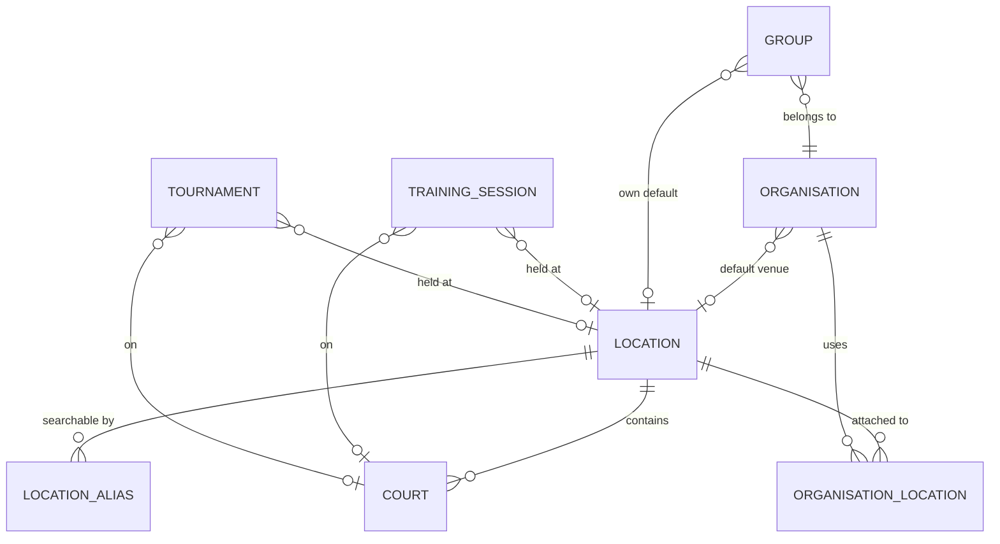

# IDENTITY 213 — Location

**Status:** Core increment implemented; organisation/group location management UI and curated import remain follow-up work.

This document is the identity record for the Location domain: what it is, how it
is modelled, which rules the server enforces, and which parts of the product
depend on it. The phase-by-phase build record lives alongside it — see
[Phase 0 — Repository audit](IDENTITY_213_Location/PHASE_0_REPOSITORY_AUDIT.md)
through
[Phase 11 — QA and rollout status](IDENTITY_213_Location/PHASE_11_QA_ROLLOUT.md).

## 1. What a Location is

A Location is a physical venue — a beach, an indoor hall, a park, a club — that
beach volleyball is played at. It is a **canonical, shared** record: the same
"Coogee Beach" is one row in the catalogue, referenced by every organisation,
group, training session and tournament that happens there. It is not an
address string and not an event.

That distinction is the whole point of the domain. Before it, every event
carried its own free-text `location` string and there was no way to ask "where
does this club play?" — only "what did someone type?".

### The four states a Location moves through

| Dimension | Values | Meaning |
|---|---|---|
| `status` | `active`, `archived`, `merged` | Whether the record is still usable, retired, or folded into another record. |
| `verification_status` | `proposed`, `verified`, `rejected` | Whether a curator has confirmed the venue is real and correctly named. |
| `geocoding_status` | `not_requested`, `pending`, `resolved`, `failed`, `manual` | How its coordinates were (or were not) obtained. |
| `coordinate_source` | free text, e.g. `geoapify`, `manual` | Which provider or person produced the coordinates. |

`selectable?` — active **and** verified — is the gate for attaching a venue to
an organisation, naming it as a default, and selecting it on an event. A
proposal is visible to the person who made it and to nobody else; a verified
venue is visible to everyone.

## 2. Domain model



### Tables

- **`locations`** — the canonical venue. Carries `name`, `normalized_name`,
  `location_type`, `formatted_address`, `locality`, `administrative_area`,
  `country_code`, `timezone`, `latitude`, `longitude`, and the four lifecycle
  dimensions above. `normalized_name` is a transliterated, lower-cased form
  used for matching and scoped uniqueness; `location_aliases` holds
  alternative names ("Bondi Beach" vs "Bondi") so search finds a venue without
  auto-merging records.

- **`location_aliases`** — alternative names and sources for a Location.

- **`courts`** — a named, optionally-mapped playing surface inside a Location,
  with its own optional coordinates and access instructions. One venue may
  have many courts; a court's name is unique within its Location.

- **`organisation_locations`** — the attachment of a Location to an
  Organisation, with a free-text `notes` column. A unique index on
  `(organisation_id, location_id)` makes the attachment idempotent.

### Notable model rules

- Latitude and longitude must be **both present or both absent**, and are
  range-checked to ±90 / ±180.
- `country_code` is exactly two characters and is normalized to upper case.
- A Location that claims to be verified must carry provenance
  (`verified_by_account` / `verified_at`).
- Every dependent — courts, organisation attachments, default organisations and
  groups, training sessions, tournaments — is `restrict_with_error`. A Location
  that is in use is **archived**, never deleted; the destructive path is
  reserved for a record nothing points at.
- A Location may be merged into another via `merged_into_id`. The merge target
  must itself be valid.

## 3. Organisation and Group association

An Organisation may use several venues, and one of them is its **default** —
the place its events normally happen.

- `organisation_locations` is a many-to-many attachment, not a column, so one
  venue can serve several clubs and an organisation can have a home ground
  plus a second and third venue.
- `organisations.default_location_id` and `groups.default_location_id` are
  nullable pointers to a Location.
- **The default must be one of the organisation's own attached locations**, and
  must be active and verified. The server refuses anything else rather than
  silently dropping it.
- A Group may override the organisation's default, or inherit it. The
  inheritance is resolved **server-side** by `LocationDefaultResolver`:
  group default → organisation default → none. The client never re-implements
  that precedence.

### Why default and attachment are separate acts

Setting a default is *not* attaching a venue. The server enforces the order:
attach first, then mark the default. This is deliberate — a default pointing at
a venue the organisation does not use would make "the club's home ground" a
question with two answers.

The consequence for the UI is that "Remove" is disabled on the current default.
The organisation must point its default somewhere else first. The server
enforces the same rule independently.

### Default changes do not move existing events

A tournament recorded at Bondi Beach stays at Bondi Beach after the club
changes its default to Coogee. Defaults are a *starting point* for new events,
never a retroactive edit of history. This is why the frontend prefill (below)
is a suggestion the organiser can override, and why the server applies a
default only at creation time.

## 4. Geocoding

Coordinates are resolved asynchronously by `LocationGeocodingJob`, never
synchronously in a user request.

- The provider is Geoapify (`Geocoding::Client` → `Geocoding::Providers::Geoapify`).
  Requests carry an identifying `User-Agent`, explicit open/read timeouts, and
  one-result queries.
- Successful lookups are cached for 30 days, no-result lookups for 24 hours.
  Provider and network failures are **not** cached.
- Query fingerprints make jobs idempotent: a stale job cannot overwrite a
  newer address.
- Curator-supplied coordinates are stored as `geocoding_status: manual` and
  `coordinate_source: manual`, and the worker never overwrites them.
- A failed lookup sets `geocoding_status: "failed"` — it does not raise a 500
  and it does not delete the proposal. The venue survives a provider outage.

### Configuration

```text
GEOCODING_ENABLED=true
GEOCODING_PROVIDER=geoapify
GEOAPIFY_API_KEY=...
GEOCODING_USER_AGENT=BeachVolleyballHub/1.0 (operations contact)
GEOCODING_OPEN_TIMEOUT=3
GEOCODING_READ_TIMEOUT=5
```

With geocoding disabled or no key configured, proposal creation still works
and the Location stays `not_requested`. The browser never receives the
provider key.

## 5. Event links

Both event types carry a nullable canonical Location and a nullable Court.

- `TrainingSession.canonical_location` — named this way to avoid colliding
  with Active Record's `location` attribute method. The legacy free-text
  `location` column remains readable and writable for compatibility.
- `Tournament.location_id` plus the pre-existing `location_name`, `city`,
  `state` and `country` free-text columns.
- A Court must belong to the selected Location.
- A selected Location must be active and verified.

## 6. API surface

| Method | Path | Notes |
|---|---|---|
| `GET` | `/api/v1/locations` | Paginated. `q`, `status`, `verification_status` filters. Ordinary users see only locations they may use. |
| `GET` | `/api/v1/locations/:id` | Detail, including aliases and courts. |
| `POST` | `/api/v1/locations` | Proposal. Browser-supplied coordinates are stripped. |
| `PATCH` | `/api/v1/locations/:id` | Curator/admin only. |
| `POST` | `/api/v1/locations/:id/verify` | Curator/admin only. |
| `POST` | `/api/v1/locations/:id/archive` | Curator/admin only. |
| `DELETE` | `/api/v1/locations/:id` | Hard delete, refused while dependents exist. |
| `GET`/`POST` | `/api/v1/locations/:location_id/courts` | |
| `PATCH`/`DELETE` | `/api/v1/locations/:location_id/courts/:id` | |
| `GET` | `/api/v1/organisations/:organisation_id/locations` | Attached venues, each with its association id and default flag. |
| `POST` | `/api/v1/organisations/:organisation_id/locations` | Attach a venue. Idempotent; re-attaching updates the note. |
| `DELETE` | `/api/v1/organisations/:organisation_id/locations/:id` | Detach. `:id` is the **association** id, not the Location id. Refused for the current default. |
| `PATCH` | `/api/v1/organisations/:id` | Accepts `default_location_id`. |

### Authorization

- Any authenticated user may propose a Location.
- Ordinary users list and select only active verified Locations (plus their own
  proposals).
- Curators and admins may edit canonical data, verify, archive and manage
  Courts.
- Organisation **editors** (owner/administrator/creator, or curator/admin) may
  attach and detach their organisation's Locations — but attaching a venue
  grants no authority over that venue's canonical coordinates.
## 7. Frontend surfaces

### `/settings/locations`

The admin catalogue: server-side pagination (20/page), search, an edit page, a
delete action, and a coordinates column. Location edit and create forms both
accept a manual latitude/longitude pair as well as an address; changing the
address re-resolves coordinates, and setting coordinates reverse-geocodes the
address.

### Organisation detail — Locations section

An organisation's detail page lists its attached venues, marks the default,
and lets an editor attach a verified venue, set a default, and detach one. The
attach picker searches the verified catalogue server-side rather than
dumping every venue into a dropdown.

### Event form prefill

The Tournament form pre-fills from the selected organisation's
`default_location`; the Training form pre-fills from the selected group's
`effective_default_location` (the group's own default, else its
organisation's).

**The prefill never overwrites what the user entered.** Each field is filled
only while it is empty or still holds a value an earlier prefill wrote. Once
the organiser edits a field — chooses a venue, types a city, picks a timezone —
that field is theirs and no later prefill touches it. Changing the
organisation replaces the previous *suggestion*, not the organiser's *work*.

The prefill is also a convenience, not a contract: the venue dropdown lists
only the first page of the catalogue, so a default venue outside that page is
added to the local list rather than silently dropped, and its courts are
loaded alongside it.

## 8. Deliberate non-goals and deferred work

- **Multi-court tournament allocation and match-level court assignment.** An
  event supports one optional Court.
- **Court booking and availability.** Out of scope entirely.
- **Embedded Google Maps.** The repositories hold no approved Maps key,
  quota, billing policy or environment contract. Venue pages expose
  provider-free Google Maps directions links instead.
- **Places autocomplete.** Deferred so proposal creation cannot spend one
  provider credit per keystroke.
- **Curated Sydney import.** Deferred pending a reviewed dataset with
  authoritative names, addresses, coordinates and licensing. Importing search
  results or guessing coordinates would violate the provenance requirements.
- **Merge execution tooling and proximity-based duplicate detection.** The
  schema supports both; the tooling is not built.
- **Legacy backfill.** `bin/rails locations:backfill_report` reports unmatched
  legacy values without mutating data. Applying it to production requires
  manual review of each candidate.

## 9. Validation

- Focused Rails location suite (model, relationships, event assignment, API
  controller): 18 runs, 57 assertions, 0 failures, 0 errors.
- Affected Tournament/Training model, service and request suite: 128 runs,
  478 assertions, 0 failures, 1 existing skip.
- Frontend location suite (organisation locations component, organisation detail,
  tournament form, training form): 3 files, 43 tests.
- Full frontend suite: 104 files, 1,027 tests.
- Frontend production TypeScript/Vite build passes; ESLint reports no errors.

The full Rails suite carries pre-existing failures in organisation/group
membership expectations, environment-dependent health/email tests and
time-sensitive tournament participation tests. They are outside the Location
implementation and were not masked.
