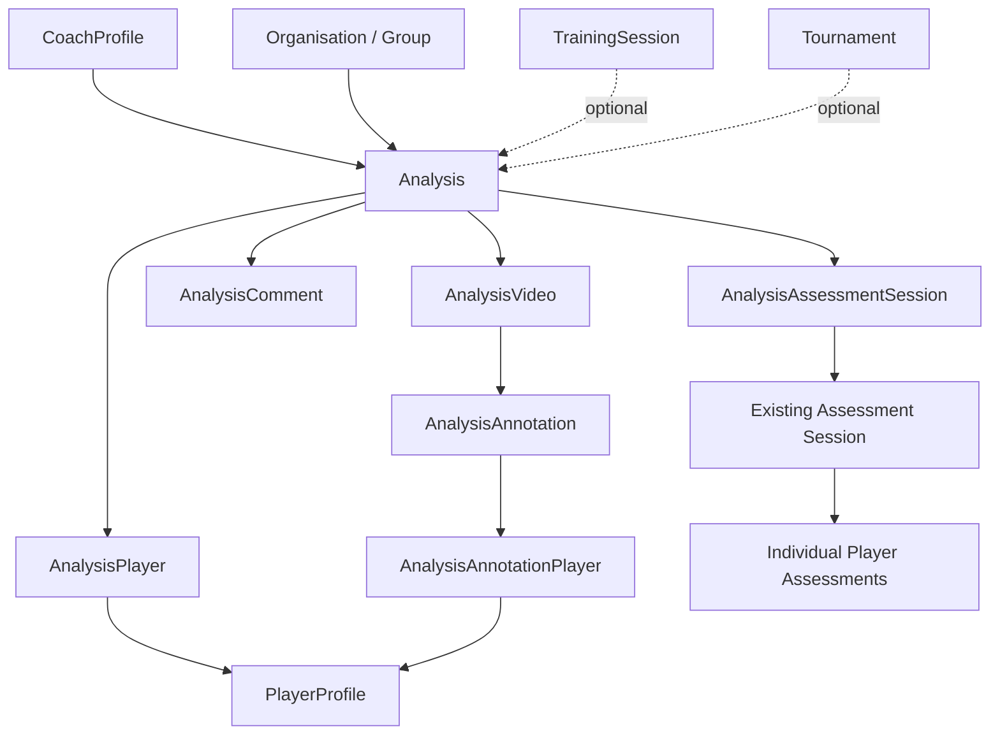

# BeachVolleyballHub — Video Analysis & Assessment Implementation Plan

**Status:** Proposed implementation plan (repository audit required)  
**Backend:** https://github.com/romalopes/beachvolleyballhub_api  
**Frontend:** https://github.com/romalopes/beachvolleyballhub_frontend  
**Suggested repository destination:** `docs/FUTURE/Analysis/VIDEO_ANALYSIS_IMPLEMENTATION_PLAN.md`

> This plan is based on the requested features and known project architecture (Rails API, React/Vite, PostgreSQL, Active Storage/R2, RBAC). It is **not** a verified audit of current repository contents. AI prompts below explicitly require inspecting the latest code before choosing model names, endpoints, or migrations.

## 1. Product vision and scope

Coaches can create an **Analysis** using one or more videos (external URL or uploaded file), associate one or more `PlayerProfile` records, write notes, annotate moments in footage, discuss findings in comments, and optionally link the analysis to a training session and/or tournament. Coaches can subsequently create or link an **Assessment Session** and assess each participating player. Add navigation from the sidebar and home page. Provide a future-proof **Hire Analysis** entry point for paid analysis requests.

### MVP acceptance criteria

- [ ] Coach can create, edit, view, archive and delete analyses according to permission policy.
- [ ] Coach can add multiple participating players, with organisation/group-scoped selection.
- [ ] Each analysis supports multiple videos; each video is either an external URL or an upload.
- [ ] Uploaded videos use existing Active Storage and R2 integration, not Render local disk.
- [ ] Each analysis supports summary notes, player-specific notes and timestamp annotations.
- [ ] Comments are authorised, attributed, timestamped and optionally threaded.
- [ ] Analysis may link to a `TrainingSession`, `Tournament`, both, or neither.
- [ ] Coaches can initiate/link an Assessment Session and assess individual players using existing assessment/skill structures.
- [ ] Sidebar and home page link to Analysis; list has filters, sorting and pagination.
- [ ] Hire Analysis entry is visible and honestly marked Coming Soon or backed by a working request flow.
- [ ] Participants only see published analyses shared with them and only their own private assessment results.
- [ ] Video access and metadata APIs are permission-checked; all key workflows have tests.

### Explicitly deferred

Frame-accurate drawing tools, trimming/transcoding pipeline, AI auto-analysis, automatic assessment scoring, multi-angle synchronisation, payments, coach marketplace matching, public galleries and native mobile editing.

## 2. Preliminary repository audit — mandatory first step

Inspect actual Rails models, migrations, routes, serializers, policies, background jobs, notifications, R2/Active Storage settings, frontend routing, sidebar/home components, forms, API clients, and existing Assessment Session / skill taxonomy. Record verified class names and associations. Do not invent new `AssessmentSession` or skill models if equivalents already exist. Check current `TrainingSession`, `Tournament`, `Organisation`, `Group`, `CoachProfile`, `PlayerProfile`, `Account` and permission conventions. Determine whether player profiles can be unclaimed and how to handle invitations/claims.

**Outputs:** `docs/FUTURE/Analysis/01_REPOSITORY_AUDIT.md`, verified dependency diagram, gaps, risk register and revised schema/API proposal. **Gate:** approval of proposed reuse before migrations.

### AI prompt — repository audit

```text
You are a senior Rails 8 / React TypeScript architect working on BeachVolleyballHub.
Inspect the CURRENT checked-out repositories in full where relevant:
- API: https://github.com/romalopes/beachvolleyballhub_api
- Frontend: https://github.com/romalopes/beachvolleyballhub_frontend

Task: design a Video Analysis module WITHOUT changing code yet.
1. Identify real existing models/tables for Account, CoachProfile, PlayerProfile, Organisation, Group, TrainingSession, Tournament, assessment sessions, skills, RBAC, comments, notifications and attachments.
2. Locate actual API patterns, policies, JSON conventions, error responses, pagination and test tools.
3. Locate frontend routes, sidebar/home page, design system, API clients, auth and test conventions.
4. Confirm Active Storage/R2 setup, upload size/security constraints and available background processing.
5. List reusable components and incompatibilities; distinguish verified facts from assumptions.
6. Propose exact schema, relationship cardinalities, indexes, permission checks, routes and UI pages.
7. Create docs/FUTURE/Analysis/01_REPOSITORY_AUDIT.md with file-path evidence and an ordered implementation backlog.
Do not invent missing classes; do not write migrations until the architecture is reviewed.
```

## 3. Domain model and lifecycle

### 3.1 Proposed entities (adapt to actual repository)

| Entity | Key fields / associations | Notes |
|---|---|---|
| `Analysis` | title, objective/description, summary_notes, status, visibility, author `CoachProfile`, organisation/group, optional training/tournament, published_at | Main resource; audit creator/updater |
| `AnalysisPlayer` | analysis_id, player_profile_id, participation role, private player_notes | Unique pair; visibility rules |
| `AnalysisVideo` | analysis_id, source_type (`upload`/`external`), url, provider, title, position, metadata, attachment | Exactly one source; multiple ordered videos |
| `AnalysisAnnotation` | analysis_video_id, author, start_ms, end_ms, body, skill/category reference | Optionally many targeted players via join |
| `AnalysisAnnotationPlayer` | annotation_id, player_profile_id | Player-specific annotation targeting |
| `AnalysisComment` | analysis_id, author account/profile, parent_id nullable, body, optional annotation_id | Avoid duplicate generic comment models if present |
| `AnalysisAssessmentSession` | analysis_id, assessment_session_id | Only if many-to-many is supported/needed; use existing model |
| `AnalysisRequest` (optional foundation) | requester, requested coach, status, objective, player references, result analysis | Defer table until request form is actually enabled |

Use `bigint` timestamps in milliseconds for annotation offsets; constrain `start_ms >= 0`, `end_ms >= start_ms` if present. Validate uploaded vs URL exclusivity. Preserve ordering and stable identifiers. Add foreign keys, unique indexes, scoped indexes (`organisation_id`, `coach_profile_id`, `status`, `created_at`) and safe deletion rules. Confirm whether `Group` belongs to `Organisation` before adding both foreign keys. Consider separate `AnalysisVideo` access records only if required by current policies.

### 3.2 Relationships



### 3.3 State transitions

- `draft`: coach-only editing; videos may be uploading/processing.
- `in_progress`: coach actively annotating; still private by default.
- `completed`: coach finished reviewing; not necessarily shared.
- `published`: authorised participants may view according to visibility and release rules.
- `archived`: retained, read-only by default; preserve assessment links.

Define allowed transitions centrally and test them. Publication must require at least one valid video and one participant unless the product explicitly supports team-only footage. Deleting a published analysis should be soft-delete/archive by default to protect assessment history; hard-delete only under explicit retention policy.

## 4. Authorisation, privacy and consent

- Reuse existing RBAC and organisation-scoping policies. Never infer permission from a client-supplied `coach_profile_id`.
- Coach can manage their own or delegated analyses; organisation administrators/curators only within their permitted scope.
- A player with a linked account can see only published analyses explicitly shared with them; an unclaimed profile does not automatically grant account access.
- Participant visibility must not expose other players' private assessment scores or private notes.
- Organisation visibility is opt-in and should account for consent of everyone appearing in video.
- All endpoints, attachment URLs, comment actions, annotations, and assessment links must enforce object-level authorisation.
- Protect minors and bystanders: consent workflow, restricted sharing, takedown/deletion, audit logging and configurable retention.
- Use short-lived signed downloads/stream access where possible; document limits of R2 public buckets, browser caches and external hosts.
- External videos: allowlist `https` schemes/providers, validate URLs, guard against SSRF if backend fetches metadata, never blindly iframe arbitrary URLs.
- Sanitise user-entered rich text; prevent XSS in comments and notes. Rate-limit comments and uploads.

### AI prompt — permissions and threat model

```text
Using the verified BeachVolleyballHub RBAC and identity models, create an authorisation matrix for Analysis, AnalysisVideo, AnalysisAnnotation, AnalysisComment and Assessment links.
Cover coaches, curators, admins, invited/claimed/unclaimed player profiles, cross-organisation access, published vs draft content, private player notes, consent, and video attachments.
Implement or propose policy classes following existing conventions. Add negative tests for IDOR, cross-tenant leakage, unauthorised signed video access, archived resources and nested record ownership.
Do not broaden existing global admin rights without verifying intended semantics. Document security tradeoffs and migration implications.
```

## 5. Backend API contract (provisional)

Follow actual route conventions; paths below are illustrative.

| Method | Route | Purpose |
|---|---|---|
| GET | `/api/analyses` | List scoped analyses, filters/sort/pagination |
| POST | `/api/analyses` | Create analysis and participants |
| GET | `/api/analyses/:id` | Detail, permission-filtered nested data |
| PATCH | `/api/analyses/:id` | Update, status transitions |
| DELETE | `/api/analyses/:id` | Archive or policy-approved delete |
| POST | `/api/analyses/:id/videos` | Add URL or initiate/upload attachment |
| PATCH/DELETE | `/api/analyses/:id/videos/:video_id` | Edit/reorder/remove video |
| POST | `/api/analyses/:id/annotations` | Add timestamp annotation |
| PATCH/DELETE | `/api/analyses/:id/annotations/:annotation_id` | Edit/remove annotation |
| GET/POST | `/api/analyses/:id/comments` | List/create discussion |
| PATCH/DELETE | `/api/analyses/:id/comments/:comment_id` | Edit/delete authorised comment |
| POST | `/api/analyses/:id/assessment_sessions` | Create/link assessment session |
| DELETE | `/api/analyses/:id/assessment_sessions/:id` | Unlink without destroying assessment |

List query candidates: `status`, `organisation_id`, `group_id`, `coach_profile_id`, `player_profile_id`, `mine`, `training_session_id`, `tournament_id`, `q`, `sort`, `direction`, `page`, `per_page`. Allowlist sort keys; enforce server-side scopes. Provide consistent pagination metadata and deterministic secondary sorting. Design bulk participant assignment with transactional validation.

### AI prompt — backend models/migrations

```text
Implement Phase 2 for the Video Analysis module in the CURRENT Rails API after reading 01_REPOSITORY_AUDIT.md.
Create only the minimum new models and migrations needed; reuse existing Account, CoachProfile, PlayerProfile, Organisation/Group, TrainingSession, Tournament, Assessment and comment patterns where applicable.
Add foreign keys, uniqueness constraints, check constraints, indexes, validations, safe status transitions, scopes and factories/fixtures.
Use transactional participant assignment. Preserve history for published analyses and linked assessments. Avoid N+1 queries.
Write model/request tests, including invalid source types, cross-organisation relationships, duplicate players and deletion semantics.
Show schema diffs and explain any deviations from the plan. Run repository-standard tests and lint; report results, not guesses.
```

### AI prompt — API endpoints

```text
Using the existing Rails API controller, serializer, policy and pagination conventions, implement authorised CRUD endpoints for analyses, participants, videos, annotations, comments and assessment links.
Define exact JSON request/response examples and error handling. Validate nested ownership and prevent mass assignment of coach/organisation IDs.
Use server-side filter scopes and allowlisted sorting. Keep endpoints idempotent where appropriate.
Add request specs for authenticated/unauthenticated access, permissions, pagination, filters, status transitions, invalid inputs and cross-tenant leakage.
Update API documentation and provide example curl commands. Do not silently change existing endpoints.
```

## 6. Video storage and playback

### Uploads

Reuse Active Storage and Cloudflare R2. Confirm direct-upload support and CORS, upload credentials, attachment private/public configuration, content types and size limits. Prefer direct-to-object-store upload with a backend-issued, authorised upload session, not proxying large files through Rails/Render. Use checksums and metadata; handle orphaned uploads, interrupted uploads and safe purge. Make max file size/configuration explicit. Decide whether playback uses signed R2 access, proxy endpoints or another supported streaming path; test HTTP range requests and browser seeking. Do not claim secure access if bucket URLs are public.

### External URLs

Initially support a documented provider allowlist (e.g., YouTube/Vimeo) plus direct HTTPS video files where technically possible. Store provider/video ID and original URL. Providers may block embedding or accurate seeking. Do not promise annotations can always auto-seek; show fallback timestamp text. Do not download external content without explicit legal/product requirements.

### AI prompt — video integration

```text
Implement AnalysisVideo using the project's VERIFIED Active Storage/R2 setup and existing frontend upload conventions.
Support ordered videos of exactly one source type: uploaded attachment OR validated external HTTPS URL.
For uploads, use direct uploads where available, private access, content type/size validation, progress/error states and safe deletion. Verify CORS, HTTP Range seeking and signed URL expiry on production-like storage.
For external sources, build a provider adapter for supported embeds; reject unsafe URLs, avoid arbitrary iframe injection and clearly indicate when seek-to-timestamp is unavailable.
Add backend/frontend tests for invalid MIME types, oversize files, expired links, unsupported providers, failed uploads and access denial.
Document environment variables and deployment steps without exposing secrets.
```

## 7. Frontend design

### Routes (adjust to existing router)

- `/analyses` — listing, filters, sorting, search, pagination, create button and Hire Analysis CTA.
- `/analyses/new` — coach, organisation/group, participants, title/objective, optional training/tournament, videos.
- `/analyses/:id` — video playlist/player, overview, notes, annotations, comments, assessment section, publication controls.
- `/analyses/:id/edit` — edit form if separate page is consistent with project.
- `/analyses/hire` — future marketplace entry point / request form.

### Navigation

Add sidebar `Analysis` with All Analyses, My Analyses, and Hire Analysis as appropriate for role; add a home-page card linking to `/analyses`. Show participant-friendly labels such as "My Video Feedback" if appropriate without fragmenting route semantics. Respect existing sidebar permissions and responsive navigation.

### Listing

Tabs/filters: All accessible, My Analyses, Assigned to Me, Draft, In Progress, Completed, Published, Archived; organisation, group, coach, player, training, tournament, date. Sort by created/updated/title; display video count, participant count, coach, context, status and last activity. Keep filter state in URL query parameters.

### Detail screen

Use video playlist, player, annotation timeline, timecoded notes, participant chips, general notes, private player notes, comments, and linked assessments. Clicking an annotation should seek to its video offset when supported. Distinguish coach-only and player-visible content clearly. Offer Save Draft, Mark Completed and Publish according to policies.

### AI prompt — navigation and listing

```text
In the CURRENT BeachVolleyballHub React/Vite frontend, inspect router, sidebar, home page, auth, RBAC guards, API client, query state and existing list/table components.
Add an Analysis sidebar entry and homepage card, respecting current navigation design and permissions.
Implement /analyses with server-side pagination, role-scoped tabs, filters, URL-persisted state, sorting, empty/loading/error states and Hire Analysis CTA.
Reuse existing components/styles. Add typed API clients and tests. Do not mock production data or invent backend endpoints: align with the verified API contract.
```

### AI prompt — create/edit/detail UI

```text
Build Analysis create/edit/detail pages using established frontend patterns.
Create form: title, objective, organisation/group, responsible coach (only if authorised), multiple players, optional training/tournament, and multiple video URLs/uploads.
Detail: ordered video playlist, provider-aware player, notes, timestamped annotations, participant targeting, comments and assessment links.
Support draft saves, status transitions, unsaved-change warnings, responsive layout, keyboard accessibility, optimistic updates only when safe, and informative API errors.
Use strict TypeScript types, existing component library, no duplicated auth logic. Add component/integration tests and describe screenshots/manual QA cases.
```

## 8. Timestamp annotations and comments

Annotations belong to a specific video and use offsets in milliseconds. Allow optional end offset, targeted players, skill tags, severity/strength categories if existing taxonomy supports them, and author. The video duration is advisory; validate ranges once metadata is available. Display ordered annotations and optionally filter by player/skill. Comments may be top-level or replies; limit thread depth if necessary. Only notify participants when content becomes visible to them. Avoid notifying about every draft edit.

### AI prompt — annotations/comments

```text
Implement timecoded annotations and discussion for Analysis using existing comment/notification infrastructure if present.
Each annotation references one AnalysisVideo, author, start_ms, optional end_ms, body, optional skill and targeted PlayerProfiles.
Build seek-to-time UI with graceful fallback for providers without seek support. Support player filtering and ordered annotations.
Comments require authorisation, safe rendering, edit/delete ownership, optional replies and optional annotation context.
Trigger notifications only for published/shared content; avoid leaking draft notes or other players' private feedback.
Test timestamp validation, provider fallback, XSS prevention, nested resource ownership and notification visibility.
```

## 9. Assessment Session integration

Audit current assessment architecture before choosing association type. The goal is to reuse the skill/assessment taxonomy, not introduce a second scoring system. From an analysis, coach clicks **Create Assessment Session**, sees preselected players and context, and can score each player independently. Linked assessment sessions must remain valid if the analysis is archived. An assessment may cite specific video annotations as evidence, ideally via a lightweight optional reference rather than copying notes. Never automatically convert annotations into ratings without explicit coach confirmation.

**Recommended rules:** one analysis may link to multiple assessment sessions; allow an assessment session to link to multiple analyses if compatible with existing semantics. If current architecture mandates one-to-many, document the constraint and choose the smallest safe change. Player-specific assessment permissions remain enforced independently of analysis access.

### AI prompt — assessment integration

```text
Inspect the existing BeachVolleyballHub assessment/session/skill models, routes, permissions and frontend UI. Report their actual names and relationships.
Implement the smallest compatible integration between Analysis and assessment sessions. Prefer linking existing sessions rather than duplicating assessment tables.
Provide Create Assessment From Analysis with participating players preselected and optionally training/tournament context. Allow authorised linking/unlinking of existing sessions.
Each player is assessed separately; private scores must not leak to other participants. Allow optional annotation evidence links if feasible without major schema duplication.
Add request/model/UI tests for partial completion, multiple players, existing-session linking, archived analysis, unclaimed player profiles and cross-organisation access.
Document data flow and user acceptance scenarios.
```

## 10. Hire Analysis — extensibility without premature payments

MVP recommendation: create `/analyses/hire` with a clear Coming Soon state and interest/request capture **only if** there is a real storage/notification workflow. Otherwise do not display a form that discards submissions. Do not add Stripe or financial fields before pricing and service terms are decided. If requests are implemented, consider `AnalysisRequest` with requester, coach (optional), players, objectives, video references, `requested/accepted/declined/cancelled/fulfilled` status, resulting analysis and timestamps. Keep quotes/payments as future separate entities; avoid storing payment credentials.

### AI prompt — hire foundation

```text
Add a future-proof Hire Analysis entry point to the Analysis list and navigation.
First inspect whether the project has requests, bookings, payments, messaging or notifications that can be reused.
Implement /analyses/hire as either:
A) honest Coming Soon page with no misleading submit button; OR
B) a working authenticated request form with persisted AnalysisRequest, validation, requester-visible status and notification/confirmation.
Choose B only if the product owner approves accepting requests now.
Document the future transition to coach matching, quotes, payment, fulfilment and refunds. Do not implement payment processing or imply a completed purchase.
Add permission and submission tests.
```

## 11. Tests and quality gates

### Backend

- Models: valid associations, unique participants, status transitions, source exclusivity, timestamps, orphan cleanup.
- Requests: CRUD, filters, pagination, sort allowlist, unauthorised access, IDOR, cross-organisation access.
- Storage: upload constraints, signed URL access, expired URL behaviour, deletion, external URL validation.
- Assessment: correct participants, separate scoring, existing links, unlink preservation.
- Comments/annotations: ownership, sanitation, visibility, ordering, invalid timestamps.

### Frontend

- Routes and navigation visibility by role.
- List filtering/sorting and URL query persistence.
- Form validation, multi-player picker, video upload failures, external provider fallback.
- Video selection, seek-to-timestamp, note privacy, comments and publication controls.
- Assessment initiation, private score visibility and Hire Analysis entry.

### End-to-end scenarios

1. Coach creates draft for two players, uploads one video, links external video, adds annotations, publishes.
2. Linked player views published feedback; unrelated player cannot access it.
3. Coach creates assessment session from analysis, assesses each player, and returns to analysis.
4. Coach links a training session/tournament and verifies navigation in both directions.
5. Coach archives analysis; assessment history remains intact.
6. Unsupported external video / expired signed upload produces actionable error.
7. Unclaimed player profile cannot be accessed through an unrelated account.

### AI prompt — final QA

```text
Perform a full Video Analysis feature review across backend and frontend.
Run repository-standard tests, linters, type checking, build and available E2E suites. Add tests for the acceptance criteria in this plan.
Conduct a security pass for RBAC, cross-tenant IDOR, private video access, XSS, SSRF, upload validation and participant consent.
Review performance: N+1 queries, indexes, paginated lists, attachment lifecycle, video payloads and frontend lazy loading.
Produce a QA report with commands actually executed, results, outstanding failures, screenshots/manual test checklist and a deployment/rollback plan.
Do not claim tests passed if not executed.
```

## 12. Deployment, operations and cost controls

- Verify Active Storage R2 bucket permissions, CORS, signed URL behaviour, lifecycle rules and object deletion.
- Set configurable per-file limits and a per-analysis upload quota. Monitor R2 storage, operations and egress where relevant.
- Do not run heavyweight transcoding on small Render API instances; defer to a dedicated video pipeline if needed.
- Apply database migrations separately from feature exposure; gate sidebar/home links behind feature flag if existing infrastructure supports flags.
- Ensure logs/Sentry do not capture private notes, tokens or signed attachment URLs.
- Back up PostgreSQL metadata and document the independent R2 object recovery plan.
- For release, use staged rollout: coach-only internal test, limited organisation pilot, then wider publication.
- Rollback should hide UI/disable writes without dropping tables or destroying uploaded files.

### AI prompt — production rollout

```text
Prepare a production rollout checklist for BeachVolleyballHub Analysis using actual Cloudflare frontend, Render Rails API, PostgreSQL and Cloudflare R2 configuration.
Inspect real environment names and feature-flag mechanisms; do not print credentials.
Document migration ordering, environment/CORS changes, storage permission checks, HTTP Range seeking, monitoring, quotas, staged release, rollback and data retention.
Create a short operator runbook for failed uploads, inaccessible videos, permission incidents and orphaned attachments.
```

## 13. Suggested implementation sequence and PR boundaries

| PR | Scope | Exit criteria |
|---|---|---|
| 0 | Audit and architecture documentation | Exact models and permissions verified |
| 1 | Core Analysis schema, policy, CRUD API | Request/model tests pass |
| 2 | Videos, R2 uploads, provider adapters | Private playback and error cases verified |
| 3 | Sidebar, home, list, create/edit/detail | Basic coach workflow works end to end |
| 4 | Annotations, comments, notifications | Authorised timestamp feedback works |
| 5 | Assessment integration | Multi-player scoring and privacy verified |
| 6 | Hire Analysis entry | Honest placeholder or functional request form |
| 7 | E2E, security, performance, rollout | Pilot readiness checklist complete |

## 14. Product decisions requiring confirmation

1. **Publication:** Are draft analyses visible only to coach/admin until explicitly published? **Default: yes.**
2. **Video privacy:** Should all uploaded videos be private? **Default: yes.**
3. **Organisation access:** May all organisation members view published analysis? **Default: no, participants only unless consent and explicit share.**
4. **Video limits:** Maximum size, duration and count per analysis? **Default: configurable, set after storage testing.**
5. **Comments:** Can players comment? **Default: yes on published analyses shared with them.**
6. **Assessment:** Can one session link to multiple analyses? **Default: yes if compatible with existing model.**
7. **Hire Analysis:** Coming Soon vs live request intake? **Default: Coming Soon until fulfilment process exists.**
8. **Retention/consent:** Policy for minors, bystanders and deletion requests? **Must be defined before public rollout.**
9. **External video providers:** Which services are required? **Default: start with supported YouTube/Vimeo and direct HTTPS files.**

## 15. Master orchestration prompt

```text
Implement the BeachVolleyballHub Video Analysis feature using the plan in docs/FUTURE/Analysis/VIDEO_ANALYSIS_IMPLEMENTATION_PLAN.md.
Repositories: https://github.com/romalopes/beachvolleyballhub_api and https://github.com/romalopes/beachvolleyballhub_frontend.

MANDATORY PROCESS:
1. Read both repositories and complete Phase 0 audit. Do not assume model names or assessment architecture.
2. Write an implementation checklist with exact paths and proposed schema; flag decisions requiring approval.
3. Execute phases in PR-sized increments: core domain/API; video storage; frontend navigation/CRUD; annotations/comments; assessment integration; Hire Analysis; QA/deployment.
4. For each phase: explain changed files, migrations, security impact, API contract, tests and commands executed.
5. Preserve current RBAC, organisation boundaries, Account/Profile claim model, Active Storage/R2 and Rails/React conventions.
6. Never expose private videos, assessment scores, signed URLs or draft comments to unauthorised accounts.
7. Avoid duplicating existing assessment models and defer marketplace payments/AI analysis.
8. Do not merge or deploy without reporting test outcomes and any unresolved failures.

Begin with the repository audit only. Stop before schema migrations until the proposed model and permission matrix have been reviewed.
```
