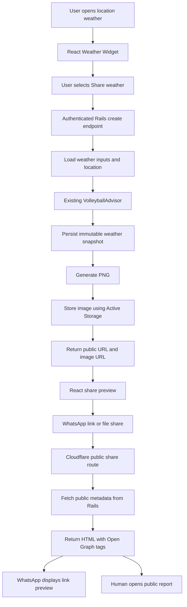

# BeachVolleyballHub --- Weather Sharing (WhatsApp) Implementation Plan

**Status:** Proposed implementation plan\
**Date:** 10 November 2026\
**Repositories:** - Frontend: `romalopes/beachvolleyballhub_frontend` -
API: `romalopes/beachvolleyballhub_api`

## 1. Goal

Allow a BeachVolleyballHub user to share weather and beach-volleyball
playing conditions for a location through WhatsApp and other sharing
channels.

The feature should produce two complementary outputs:

1.  **A public, shareable report URL** with a rich WhatsApp link
    preview.
2.  **A downloadable/shareable PNG image** that can be attached directly
    to a WhatsApp conversation or status.

The initial release is location-based. A later extension can associate a
report with a scheduled Training Session.

### Example user journey

1.  A user opens the Weather Widget for a beach volleyball location.
2.  They choose **Share weather**.
3.  The frontend asks the API to create a weather-share snapshot.
4.  The API stores the snapshot, creates a non-guessable public token,
    and generates a share image.
5.  The frontend displays a preview with actions:
    -   Share link
    -   Share image
    -   Copy link
    -   Download image
6.  The user chooses WhatsApp from the native share sheet, or copies the
    link.
7.  WhatsApp fetches the public URL and its Open Graph metadata. The
    message displays the report image and link.
8.  A recipient opens the link and sees the public report without
    needing to sign in.

## 2. Product and UX decisions

### 2.1 Share card content

The first version should keep the image readable on a phone. Avoid
trying to fit every available weather field into one graphic.

**Required:** - BeachVolleyballHub branding - Location name - Forecast
date and time - Temperature - Weather condition and icon - Wind speed
and direction - Rain probability - UV index - Volleyball conditions
rating and score - Short recommendation or warning - Short public URL or
QR code, if it remains legible

**Optional, subject to space and data availability:** - Feels-like
temperature - Humidity - Sunrise/sunset - Court-specific location
description - Small map with a marker

Do not display unavailable values as zero. Omit them or label them as
unavailable.

### 2.2 Score and recommendation

Reuse the existing `Weather::VolleyballAdvisor` calculation and the
existing configurable weights. Do not create a second scoring algorithm
for sharing.

The shared report must use the same score and rating that the existing
Weather Widget presents for the same forecast inputs. The API should
persist the score, rating, and relevant explanation/warnings as part of
the snapshot.

Do not silently reinterpret the score. Confirm the existing score scale,
rating labels, thresholds, and warning logic from the API source before
implementing.

### 2.3 Snapshot semantics

A share must represent the conditions that were used when it was
created. It must not change unexpectedly when the weather provider
refreshes.

Persist: - Weather data used for the report - Forecast target time and
timezone - Weather provider and relevant source metadata, if available -
Volleyball score and rating - Warnings/recommendation - Location name
and coordinates at creation time - Snapshot creation time

The public page should distinguish: - **Forecast for:** the target
date/time - **Report created:** when the share was generated -
**Forecast source updated:** only if the provider exposes this reliably

Do not label a forecast as current conditions unless it actually
represents current observations.

### 2.4 Public access and lifecycle

-   Viewing a valid shared report must not require authentication.
-   Creation should require the normal authenticated permissions for
    accessing the relevant weather/location feature.
-   Use a cryptographically random, unguessable public token. Do not
    expose sequential database IDs.
-   Allow the creator, and authorized administrators where appropriate,
    to revoke a share.
-   Make expiration configurable. A reasonable initial default is seven
    days, but confirm product requirements before hard-coding it.
-   Expired or revoked links should return a clear unavailable page and
    should not expose the snapshot.
-   Avoid indexing individual reports in search engines unless there is
    a deliberate product decision to make them public and discoverable.
-   Do not expose the creator's email, account details, private
    organization data, or other personal information.

### 2.5 WhatsApp behavior

Support both mechanisms:

**A. Share a link (default)** - Share a canonical public URL. - The URL
returns server-generated Open Graph metadata in the initial HTML
response. - `og:image` points to a publicly accessible, absolute HTTPS
image URL. - The preview image must not require cookies, authentication,
or JavaScript. - Set correct content types and cache headers.

**B. Share an image** - Generate a PNG. - Use the Web Share API with
`navigator.canShare({ files })` / `navigator.share({ files })` when
supported. - If file sharing is unavailable, offer download and
copy-link fallbacks. - Do not assume every browser or installed PWA
supports file sharing. - Handle user cancellation without showing an
error.

The link preview and direct image attachment are separate capabilities.
A successful link share does not prove that an image was attached.

## 3. Architecture recommendation

Use the existing Rails API and React/Vite frontend. Do not create a
separate weather service.

### 3.1 Components

**React frontend** - Share Weather action in the existing Weather Widget
or location weather view. - Share preview modal/drawer. - Share link,
share image, copy link, and download image actions. - Public weather
report route. - Mobile/PWA feature detection and graceful fallbacks.

**Rails API** - Authenticated create/revoke endpoints. - Public read
endpoint. - Snapshot creation and validation. - Public token generation
and expiration. - Image generation and storage. - Public HTML/Open Graph
response, directly or through a Cloudflare Worker integration. -
Authorization and rate limiting.

**Storage** - Use the project's existing Active Storage configuration if
present. - For the planned Cloudflare R2 integration, verify that the
configured Active Storage service can serve public share images over a
stable HTTPS URL. - Do not assume the R2 bucket is public. Use a
deliberately configured public asset domain or another supported public
delivery arrangement. - Keep private uploads and public share images
logically separated.

### 3.2 Public URL and Open Graph delivery

This is the most important technical spike because the frontend is a
React/Vite SPA and social crawlers generally need metadata in the
initial HTML response.

Preferred public URL:
`https://beachvolleyballhub.com/weather/:public_token`

The route must return initial HTML containing: - `title` -
`description` - `canonical` - `og:type` - `og:title` -
`og:description` - `og:url` - `og:image` - `og:image:secure_url` -
`og:image:type` - `og:image:width` - `og:image:height` -
`twitter:card` - `twitter:title` - `twitter:description` -
`twitter:image`

**Recommended implementation choice:** implement a narrowly scoped
Cloudflare Worker route for `/weather/:token`. The Worker fetches public
metadata from a dedicated Rails endpoint, then returns the frontend HTML
shell with safely escaped metadata inserted into the `<head>`. The
normal React app hydrates/renders the report for human visitors.

This keeps the canonical URL on the main BeachVolleyballHub domain and
avoids depending on client-side JavaScript for WhatsApp's preview
crawler.

Before choosing this approach, inspect the current Cloudflare Worker
entry point and deployment configuration. If the current Worker
architecture cannot safely support route-specific HTML responses, use a
Rails-rendered public HTML endpoint on `api.beachvolleyballhub.com` as
the simpler fallback. Do not implement both approaches unnecessarily.

Security requirements for the Worker: - Accept only the expected
`/weather/:token` path. - Validate token format and length. - Fetch only
a fixed, configured API origin; never build an upstream URL from user
input. - Escape all metadata values before inserting them into HTML. -
Do not forward user cookies or authorization headers to the metadata
endpoint. - Set an appropriate content type and conservative cache
policy. - Fail closed with a generic unavailable page if metadata cannot
be retrieved. - Do not cache revoked or expired reports beyond an
explicitly safe short period.

The Rails public metadata endpoint should return only the fields
required for the public page and social metadata. It must not expose
internal model attributes.

### 3.3 Image generation

Generate the image on the backend so it is consistent across desktop,
mobile, PWA, and WhatsApp crawlers.

Recommended starting point: - 1200 × 630 pixels for a landscape Open
Graph image. - Consider a second portrait layout for direct sharing to
WhatsApp Status. - Use a branded SVG template as the source layout. -
Convert SVG to PNG using a dependable renderer supported by the Render
Docker image.

Evaluate the conversion approach during Phase 1. Options include a small
native SVG renderer such as `resvg`, or an existing image-processing
dependency already present in the Docker image. Avoid introducing a full
headless browser unless the design genuinely requires it; Chromium adds
deployment size, memory, and maintenance overhead.

The generated image should be stored and reused. Do not regenerate it on
every crawler request.

### 3.4 Map image

The map should identify the actual location/court, not imply that the
weather provider supplies a map.

Investigate: 1. Whether the existing project already has a reusable
static-map or map snapshot implementation. 2. Google Maps Static Maps,
using the existing Google Maps project only if the API is enabled and
its billing/key restrictions are understood. 3. An OpenStreetMap-based
static map option, including tile-provider terms, attribution, caching,
and usage limits.

The image must include appropriate map attribution. If no reliable
static map source is available, use a clean location panel with a pin
and a **Open in Google Maps** link rather than shipping an unreliable
map screenshot.

The public HTML report can include an interactive or linked map
independently of the PNG.

### 3.5 Data flow



## 4. Data model proposal

Confirm existing naming conventions, UUID usage, account scoping, and
Active Storage setup before creating migrations.

### 4.1 `WeatherShare`

Suggested fields:

  -------------------------------------------------------------------------
  Field                   Type                    Notes
  ----------------------- ----------------------- -------------------------
  `id`                    Existing primary key    Internal identifier
                          convention              

  `public_token`          String, unique index    Random, unguessable token

  `location_id`           Foreign key             Original location, if
                                                  retained

  `user_id`               Foreign key             Creator

  `account_id`            Foreign key, if         Preserve existing account
                          required by current     isolation
                          tenancy model           

  `weather_snapshot`      JSON/JSONB              Immutable snapshot of
                                                  relevant weather data

  `volleyball_score`      Integer                 Snapshot score

  `volleyball_rating`     String                  Snapshot rating label

  `recommendation`        Text                    Public-safe
                                                  recommendation

  `warnings`              JSON/JSONB              Public-safe warnings

  `location_snapshot`     JSON/JSONB              Name, coordinates, court
                                                  description

  `forecast_for`          Datetime                Target forecast time

  `forecast_timezone`     String                  IANA timezone

  `provider_updated_at`   Datetime, nullable      Only if reliably supplied

  `image`                 Active Storage          Generated PNG
                          attachment              

  `status`                String or enum          Active/revoked/expired,
                                                  if useful

  `expires_at`            Datetime                Optional expiry

  `revoked_at`            Datetime                Revocation timestamp

  `created_at` /          Timestamps              Rails timestamps
  `updated_at`                                    
  -------------------------------------------------------------------------

Do not duplicate every field if the existing application already has a
suitable snapshot/value-object convention. Keep the persisted JSON
schema explicit and versioned.

### 4.2 Snapshot version

Include a `snapshot_version` integer. This allows future image/report
templates to evolve without making older records ambiguous.

### 4.3 Associations and indexes

Potential associations: - `WeatherShare belongs_to :user` -
`WeatherShare belongs_to :location` -
`WeatherShare belongs_to :account`, only if required by the existing
tenancy architecture - `WeatherShare has_one_attached :image`

Indexes: - Unique index on `public_token` - Index on
`user_id, created_at` - Index on `location_id, created_at` - Index on
`expires_at` if cleanup queries need it - Index on `status` if status is
persisted and queried

Add foreign keys consistent with the existing API.

### 4.4 Retention

Implement a cleanup job for expired records and images only after the
expiration policy is agreed. Revocation should immediately prevent
public access even if the image remains in storage temporarily. Ensure
cleanup does not delete a file still referenced by another record.

## 5. API proposal

Adapt paths and response conventions to the existing API versioning,
authentication, serializers, and error format.

### 5.1 Create a share

`POST /api/v1/weather_shares`

Authenticated.

Example request:

``` json
{
  "location_id": 123,
  "forecast_for": "2026-11-10T18:00:00+11:00",
  "expires_in": "7_days"
}
```

The exact request should reuse the existing weather query inputs where
possible. Do not trust a client-submitted score as authoritative. The
API should calculate the score from the same server-side service used by
the existing weather functionality, or validate a clearly defined shared
input contract.

Example response:

``` json
{
  "data": {
    "id": 456,
    "public_token": "opaque-random-token",
    "share_url": "https://beachvolleyballhub.com/weather/opaque-random-token",
    "image_url": "https://configured-public-image-domain/path/image.png",
    "expires_at": "2026-11-17T05:00:00Z",
    "volleyball_score": 92,
    "volleyball_rating": "Excellent"
  }
}
```

### 5.2 Read public report

`GET /api/v1/public/weather_shares/:public_token`

Public, no authentication.

Return only public-safe snapshot fields: - Location snapshot - Forecast
date/time and timezone - Weather summary - Temperature - Wind
speed/direction - Rain probability - UV index - Score/rating -
Recommendation and warnings - Image URL - Creation and expiry
timestamps - Map/directions URL if available

Do not return creator email, internal account details, private location
notes, or unrelated associations.

### 5.3 Read Open Graph metadata

`GET /api/v1/public/weather_shares/:public_token/metadata`

Public, no authentication.

Return a small response designed for the Cloudflare Worker: - Public
title - Public description - Canonical share URL - Public image URL -
Image dimensions and media type - Valid/expired/revoked status

Do not return the complete weather snapshot if the Worker only needs
metadata.

### 5.4 Revoke a share

`DELETE /api/v1/weather_shares/:id`

Authenticated. Only the creator or an authorized administrator may
revoke it, following the existing authorization rules.

### 5.5 Optional list endpoint

Only add this if the product needs a user's share history:
`GET /api/v1/weather_shares`

Do not add a management interface merely because the model exists.

### 5.6 API implementation requirements

-   Follow current Rails API namespace and controller conventions.
-   Use existing authentication and authorization libraries.
-   Use strong parameters.
-   Validate location access and account boundaries.
-   Validate forecast date/time and timezone.
-   Generate tokens using a cryptographically secure random generator.
-   Enforce uniqueness at the database level and handle the extremely
    unlikely collision.
-   Return consistent API errors.
-   Rate-limit creation to reduce abuse and image-generation cost.
-   Make creation idempotent only if there is an established project
    pattern; otherwise avoid accidental duplicate requests in the
    frontend.

## 6. Frontend proposal

Inspect the current Weather Widget and location detail views before
choosing exact component paths.

### 6.1 Components

Suggested component responsibilities:

-   `WeatherShareButton`
    -   Opens the share flow.
    -   Disabled with a clear reason if there is no valid
        weather/location data.
-   `WeatherShareDialog` (or drawer on small screens)
    -   Requests share creation.
    -   Displays loading, success, and failure states.
    -   Shows a preview of the report.
-   `WeatherSharePreview`
    -   Displays the generated PNG and the report URL.
    -   Shows forecast target time and score.
-   `WeatherShareActions`
    -   Share link
    -   Share image
    -   Copy link
    -   Download image
-   Public report page
    -   Loads the public snapshot.
    -   Shows the same data represented by the image.
    -   Includes a map/directions link.
    -   Shows a clear expired/revoked state.

Use existing design-system components and accessibility patterns. Do not
create a second modal system if the app already has one.

### 6.2 Share behavior

Suggested logic:

1.  Create the share via the API.
2.  Display the returned image and URL.
3.  For link sharing:
    -   Use `navigator.share({ title, text, url })` when available.
    -   Otherwise use a WhatsApp share URL with an encoded message and
        URL, or copy the link.
4.  For image sharing:
    -   Fetch the generated image as a Blob.
    -   Create a `File` with a correct MIME type.
    -   Check `navigator.canShare({ files: [file] })`.
    -   If supported, call
        `navigator.share({ files: [file], title, text })` from the
        user's direct click.
    -   If unsupported, offer download and link sharing.
5.  Handle `AbortError` as user cancellation, not a failed operation.

Do not promise that the WhatsApp application will always be selected
automatically. The native share sheet controls the available targets.

### 6.3 Mobile, PWA, and Capacitor

-   Test mobile Safari and Chrome on Android.
-   Test installed PWA behavior separately from browser-tab behavior.
-   Test Capacitor WebView behavior when the native app work begins.
-   Keep a browser fallback for unsupported file sharing.
-   Do not introduce React Native.
-   Avoid a dependency on a native WhatsApp SDK for the initial version.

## 7. Security, privacy, and abuse protection

This feature creates public URLs and image-generation work, so it needs
explicit protections.

### Public report security

-   Unguessable tokens with sufficient entropy.
-   No sequential public IDs.
-   Public serializers/DTOs with allowlisted fields.
-   No private account, user, or organization data.
-   Revoke and expiry checks on every public request, including image
    access if the image is served through an application-controlled
    endpoint.
-   Generic responses for unknown, revoked, and expired tokens where
    appropriate to avoid leaking record existence.
-   Correct HTML escaping in metadata and templates.

### API protection

-   Authentication for creation and revocation.
-   Authorization for the selected location.
-   Per-user and per-IP creation rate limits.
-   Request size and input validation.
-   Avoid repeated image generation for the same share.
-   Add reasonable limits to public metadata/report requests.
-   Monitor spikes in 404/invalid-token and create requests.
-   Reuse the project's broader API abuse-protection work rather than
    inventing an isolated rate-limiting system.

### Image delivery

-   Use HTTPS.
-   Use a stable public URL.
-   Do not put secrets or personal information in image URLs.
-   Set correct `Content-Type`.
-   Use immutable or versioned image URLs.
-   Avoid very long public caching if immediate revocation is required.
    If the image is cached by a CDN or WhatsApp, revocation may not
    erase copies already cached or downloaded; explain this limitation
    in product policy.

### Privacy note

A public share link is intentionally viewable by anyone who receives it.
The UI should make this clear before the first share. Do not include a
person's name or account details in the report by default.

## 8. Caching and performance

-   Generate the PNG once per share.
-   Store the image and reuse it for all social crawler requests.
-   Cache valid public metadata for a short, controlled period.
-   Keep revocation and expiration behavior in mind when selecting cache
    TTLs.
-   Avoid making live weather-provider calls when a recipient opens a
    report.
-   The public report should render from the stored snapshot.
-   Track image-generation duration and failures.
-   If image generation is asynchronous, return a processing state and
    poll or refresh briefly; do not make the user wait indefinitely.

For the first release, synchronous generation may be acceptable if it is
reliably fast. Measure it before adding a background job. If generation
is slow or resource-intensive, move it to the existing Active Job/queue
infrastructure.

## 9. Observability

Add structured events/logging for: - Weather share created - Image
generated or failed - Public report viewed - Share revoked - Share
expired - Link share initiated (frontend event, if analytics exists) -
Image share initiated (frontend event, if analytics exists)

Avoid logging public tokens in plaintext where possible. Use an internal
record ID or a one-way token fingerprint for operational logs.

Useful metrics: - Share creation count - Image generation
success/failure rate - Average image generation duration - Public report
views - Expired/revoked access attempts - API rate-limit responses

Do not collect precise recipient identities or attempt to identify
WhatsApp recipients.

## 10. Testing strategy

### API/model tests

-   Token generation and uniqueness.
-   Snapshot is immutable after creation.
-   Correct location and account authorization.
-   Creator/admin revoke permissions.
-   Expiration behavior.
-   Revoked reports are inaccessible.
-   Public serializer exposes only allowlisted fields.
-   Missing optional weather values are handled correctly.
-   Score and rating match `Weather::VolleyballAdvisor`.
-   Invalid forecast date/time and timezone are rejected.
-   Rate limits work.

### Image tests

-   PNG is generated with expected dimensions.
-   Correct content type.
-   Required labels and values are represented.
-   Missing weather fields do not render misleading zeroes.
-   Long location names do not overflow.
-   Wind direction and units are correct.
-   Map attribution is present when a map is used.
-   Image is readable at phone display size.
-   Snapshot values match image values.

### Open Graph tests

-   Initial HTML contains all required metadata.
-   Metadata values are HTML-escaped.
-   `og:image` is an absolute HTTPS URL.
-   Image URL is publicly accessible without authentication.
-   Correct image MIME type and dimensions.
-   Expired and revoked tokens do not return active metadata.
-   Unknown token returns a safe unavailable page.
-   Cloudflare Worker does not allow arbitrary upstream URL injection.

### Frontend tests

-   Share action opens the dialog.
-   Loading and error states work.
-   Link can be copied.
-   Link sharing uses the native share sheet when supported.
-   Image sharing checks `canShare`.
-   Unsupported file sharing exposes download fallback.
-   User cancellation does not show an error.
-   Public page handles loading, valid, expired, revoked, and
    unavailable states.
-   Keyboard and screen-reader accessibility.

### End-to-end/manual tests

Test with actual social crawlers and devices. A browser preview is not
proof that WhatsApp will render the same result.

-   WhatsApp on iOS
-   WhatsApp on Android
-   WhatsApp Web/Desktop
-   Facebook Sharing Debugger or equivalent Open Graph inspection tool
-   Chrome desktop
-   Safari iOS
-   Android Chrome
-   Installed PWA
-   Capacitor later

Verify that WhatsApp fetches the correct image after the report is
created. Social platforms may cache link previews, so use a new token
when retesting metadata changes.

## 11. Implementation phases and AI coding prompts

Work in small phases. Each prompt should instruct the coding agent to
inspect the actual repositories and existing patterns first, implement
only the stated scope, run tests, and report changed files and
unresolved questions. Do not let the agent guess file paths or invent
existing functionality.

------------------------------------------------------------------------

### Phase 0 --- Repository discovery and technical design

**Goal:** Understand the current weather implementation and hosting
architecture before changing code.

**API repository investigation:** - Find `Weather::VolleyballAdvisor`
and its tests. - Identify weather provider/service objects and the exact
weather response shape. - Identify how weather scores, weights,
thresholds, and warnings are configured. - Inspect Location, Account,
User, and authorization associations. - Inspect API versioning,
serializers, authentication, policies, rate limiting, and error
conventions. - Inspect Active Storage and current R2 configuration, if
implemented. - Inspect Active Job/queue setup. - Inspect Dockerfile and
Render deployment configuration.

**Frontend repository investigation:** - Find the Weather Widget and
location detail/map components. - Identify the API client,
authentication handling, routing, modal/dialog components, and design
system. - Inspect PWA configuration and current service-worker
behavior. - Inspect Cloudflare Worker entry point, `wrangler`
configuration, assets routing, and deployment scripts. - Identify
current domain and environment variable conventions.

**Deliverable:** A short architecture report with exact file paths,
current patterns, gaps, proposed implementation choices, and questions
that require a product decision.

**AI coding prompt:**

> Inspect the BeachVolleyballHub frontend and API repositories. Do not
> modify any files yet.
>
> Trace the complete current weather flow from the React Weather Widget
> to the Rails API and the `Weather::VolleyballAdvisor` calculation.
> Identify the exact weather fields, units, forecast-time behavior,
> score/rating behavior, warning logic, location coordinate source, and
> relevant tests.
>
> Inspect the current Rails models, account scoping,
> authentication/authorization, serializers, API conventions, Active
> Storage, background jobs, rate limiting, Docker/Render configuration,
> and Cloudflare Worker deployment.
>
> In the frontend, inspect routing, API client conventions, UI
> components, PWA behavior, and the current Worker/assets setup.
>
> Produce a technical discovery report with exact repository paths and
> recommendations for a WeatherShare implementation. Specifically
> assess: 1. Best way to persist an immutable weather snapshot. 2. Best
> way to generate a PNG on the existing Render Docker infrastructure. 3.
> Best way to store and publicly serve the generated image. 4. Best way
> to return initial HTML with Open Graph tags at
> `beachvolleyballhub.com/weather/:token`. 5. Best static-map option and
> its cost/licensing implications. 6. Existing rate-limiting and job
> infrastructure that should be reused.
>
> Do not assume a feature or dependency exists without finding it. Do
> not change code. List any product decisions that must be confirmed.

**Acceptance criteria:** - Exact paths and existing implementations are
documented. - No code is modified. - Open Graph hosting and PNG
generation risks are explicitly resolved or presented as options.

------------------------------------------------------------------------

### Phase 1 --- Share-card and public-report design

**Goal:** Finalize the visual hierarchy and content contract before
implementation.

Tasks: - Design a 1200 × 630 landscape image. - Decide whether to
include a map image in the first release. - Define a portrait image
variant only if there is a clear Status-sharing use case. - Define
missing-data behavior. - Confirm score labels and warning wording from
the existing advisor. - Define public report layout for desktop and
mobile. - Define forecast timestamp and timezone presentation.

**AI coding prompt:**

> Based on the Phase 0 discovery report, propose the Weather Share
> visual design for BeachVolleyballHub.
>
> Create a concise content specification for: 1. The 1200 × 630 Open
> Graph PNG. 2. The public weather report page. 3. The mobile share
> preview dialog.
>
> Reuse the existing BeachVolleyballHub visual design system and
> existing Weather Widget terminology. Do not create new scoring labels
> or thresholds. Include location, forecast target time, temperature,
> weather summary, wind speed/direction, rain probability, UV,
> volleyball score/rating, and warnings where data exists.
>
> Show how the layout handles missing values, long location names, and
> warnings. Recommend whether the map belongs in the first image
> version. Do not modify application code until the design/content
> contract is approved.

**Acceptance criteria:** - Image and page content are defined. - Score
and warning language match the existing advisor. - Missing data is
handled explicitly. - The map decision is documented.

------------------------------------------------------------------------

### Phase 2 --- WeatherShare data model and snapshot service

**Goal:** Create the persistent, immutable share snapshot.

Tasks: - Add migration and model. - Add secure public token
generation. - Add snapshot version. - Define explicit JSON snapshot
structure. - Add associations and indexes. - Implement a service object
that builds the snapshot from existing weather/location services. -
Reuse `Weather::VolleyballAdvisor`. - Add model/service tests.

**AI coding prompt:**

> Implement Phase 2 in the BeachVolleyballHub Rails API only.
>
> First re-read the Phase 0 report and inspect the exact current models
> and services. Follow existing naming, UUID/primary-key,
> account-tenancy, validation, and testing conventions.
>
> Add a WeatherShare model and migration with a cryptographically
> secure, unique public token, snapshot version, creator,
> location/account associations as appropriate, immutable weather
> snapshot, location snapshot, forecast target time/timezone, volleyball
> score/rating, public-safe recommendation/warnings,
> expiration/revocation fields, and an Active Storage image attachment
> only if it matches the existing storage architecture.
>
> Implement a dedicated snapshot builder that obtains the same weather
> inputs and calls the existing `Weather::VolleyballAdvisor`. Do not
> duplicate its scoring logic. Do not trust a score supplied by the
> browser.
>
> Persist all values needed to reproduce the public report and image
> without another live weather-provider request. Define and test the
> JSON schema. Do not store unrelated personal or private organization
> data.
>
> Add tests for token uniqueness, snapshot creation, missing optional
> fields, score parity with the existing Weather Widget calculation,
> account/location access, and snapshot immutability.
>
> Run the relevant test suite and report migrations, changed files, test
> results, and any unresolved questions. Do not implement controllers or
> frontend changes in this phase.

**Acceptance criteria:** - Migration and model follow project
conventions. - Snapshot is self-contained and versioned. - Score/rating
are produced by the existing advisor. - Tests prove the snapshot does
not change when live weather changes.

------------------------------------------------------------------------

### Phase 3 --- Authenticated API and public report endpoints

**Goal:** Create and manage weather shares securely.

Tasks: - Authenticated create endpoint. - Public report endpoint. -
Public metadata endpoint. - Revoke endpoint. - Public-safe serializer. -
Authorization and validation. - Rate limiting. - API request tests.

**AI coding prompt:**

> Implement Phase 3 in the Rails API. Inspect the existing API
> versioning, controllers, serializers, authentication, authorization,
> error response, and rate-limiting conventions before coding.
>
> Add: - Authenticated `POST /api/v1/weather_shares`. - Public
> `GET /api/v1/public/weather_shares/:public_token`. - Public
> `GET /api/v1/public/weather_shares/:public_token/metadata`. -
> Authenticated `DELETE /api/v1/weather_shares/:id`.
>
> Adapt exact route naming to the project's conventions and document any
> deviation.
>
> Creation must validate access to the location and account, use
> server-side weather/score calculation, create the immutable snapshot,
> and return the public URL and status. The public endpoint must return
> only an explicit allowlist of public fields. The metadata endpoint
> must return only the title, description, canonical URL, image URL,
> dimensions, media type, and validity state required by the
> social-preview layer.
>
> Only the creator or an authorized administrator may revoke a share.
> Every public request must enforce expiry and revocation. Use generic
> safe responses for invalid, expired, or revoked tokens where
> appropriate.
>
> Add creation rate limits using existing infrastructure. Do not
> introduce a second rate-limiting library if the application already
> has a suitable solution.
>
> Add request, authorization, serialization, validation, expiration,
> revocation, and rate-limit tests. Run the relevant tests and report
> results.

**Acceptance criteria:** - Public requests do not require login. -
Creation and revocation are authenticated and authorized. - No private
user/account data is serialized. - Expired/revoked reports cannot be
read. - Rate limits are tested.

------------------------------------------------------------------------

### Phase 4 --- PNG image generation and storage

**Goal:** Generate a consistent, public, cached image from the snapshot.

Tasks: - Choose and document the rendering library/tool. - Add SVG
template or equivalent. - Convert to PNG. - Store using Active Storage
and configured public delivery. - Add image URL to API response. -
Handle generation failure and retries. - Test dimensions, content type,
missing fields, and layout overflow.

**AI coding prompt:**

> Implement Phase 4 in the Rails API based on the Phase 0 infrastructure
> findings and approved Phase 1 design.
>
> Generate the weather share image on the backend from the persisted
> WeatherShare snapshot only. Do not call the weather provider during
> image rendering.
>
> Use a rendering/conversion dependency that works reliably in the
> existing Render Docker environment. Prefer a lightweight SVG-to-PNG
> renderer if it meets the visual requirements. Do not add a headless
> browser without documenting why it is necessary and the deployment
> cost.
>
> Produce a 1200 × 630 PNG with BeachVolleyballHub branding, location,
> forecast target time, temperature, weather summary, wind
> speed/direction, rain probability, UV, volleyball score/rating, and
> relevant warnings. Omit unavailable fields rather than displaying
> misleading zero values.
>
> Include a map panel only if Phase 0/1 confirmed a reliable, permitted
> source. Include required attribution. Otherwise show a location/pin
> treatment and use a Google Maps directions link on the public page.
>
> Store the PNG through the existing Active Storage configuration and
> verify that the resulting URL is publicly accessible over HTTPS
> without authentication. Do not make a private bucket public as a
> shortcut; use a deliberate public delivery configuration.
>
> Generate once and reuse the image. Add error handling and a
> retry/background-job approach if generation is not reliably fast.
>
> Add tests for PNG dimensions, MIME type, snapshot/image value
> consistency, missing data, long location names, warnings, and storage
> URL behavior. Update Docker dependencies and deployment documentation
> where needed. Run tests and report image-generation timing and
> deployment implications.

**Acceptance criteria:** - A valid snapshot produces a valid 1200 × 630
PNG. - Image values exactly match the snapshot. - Image is publicly
retrievable over HTTPS. - Image generation is not repeated for every
page/crawler request. - Render Docker build succeeds.

------------------------------------------------------------------------

### Phase 5 --- Public HTML and Open Graph metadata

**Goal:** Make WhatsApp and other crawlers see a correct preview.

Tasks: - Implement the selected route strategy. - Add safe metadata
insertion. - Return canonical URL and image metadata. - Add a
human-readable public report. - Test initial HTML without JavaScript. -
Test invalid/expired/revoked states. - Set cache headers.

**AI coding prompt:**

> Implement Phase 5 using the route strategy approved in Phase 0:
> preferably a narrowly scoped Cloudflare Worker route at
> `https://beachvolleyballhub.com/weather/:token`, or the documented
> Rails-rendered fallback if the Worker approach is unsuitable.
>
> The first HTTP response for a valid share URL must contain the
> complete Open Graph and Twitter Card metadata in the HTML head. Do not
> rely on React client-side metadata updates.
>
> Fetch metadata only from the fixed configured Rails API origin and the
> dedicated public metadata endpoint. Validate the token path, escape
> every inserted value, and never construct an upstream URL from
> user-controlled input. Do not forward user cookies or authorization
> headers.
>
> Include `og:title`, `og:description`, `og:type`, `og:url`, `og:image`,
> `og:image:secure_url`, `og:image:type`, `og:image:width`,
> `og:image:height`, and corresponding Twitter Card tags. Use absolute
> HTTPS URLs.
>
> Return the frontend app shell so human visitors can see the React
> public report page, or provide a server-rendered report with a clear
> link into the app. Ensure the chosen behavior works with the current
> Cloudflare static-assets configuration.
>
> Set conservative cache headers that do not undermine revocation or
> expiration. Return a safe unavailable page for invalid, expired,
> revoked, or upstream-failure cases.
>
> Add automated tests for initial HTML metadata, HTML escaping, fixed
> upstream origin, invalid token paths, image URL, and unavailable
> states. Document how to deploy and test the Worker route.

**Acceptance criteria:** - A plain HTTP fetch sees all metadata in the
initial HTML. - Metadata contains the correct image URL and canonical
URL. - No JavaScript execution is required for crawler preview. -
User-supplied values cannot inject HTML or control the upstream URL. -
Revoked/expired shares do not receive active metadata.

------------------------------------------------------------------------

### Phase 6 --- React share flow and public report UI

**Goal:** Add the user-facing feature.

Tasks: - Add Share Weather action to the existing Weather
Widget/location view. - Add responsive share dialog. - Create share via
API. - Preview generated image. - Add link/image share, copy, and
download actions. - Add public report route. - Add
loading/error/expired/revoked states. - Add accessibility and frontend
tests.

**AI coding prompt:**

> Implement Phase 6 in the BeachVolleyballHub React/Vite frontend.
> Inspect the existing Weather Widget, location view, API client,
> routing, modal/drawer components, notifications/toasts, design system,
> and test setup first.
>
> Add a Share Weather action in the most natural existing weather UI
> location. Do not duplicate weather calculations in React.
>
> On selection, call the authenticated Rails create endpoint and display
> a responsive preview containing the generated PNG, location, forecast
> target time, score/rating, and share URL.
>
> Provide: - Share link using the Web Share API when available. -
> WhatsApp link-sharing fallback with an encoded message and URL. - Copy
> link. - Download image. - Direct image sharing using
> `navigator.canShare({ files })` and `navigator.share({ files })` when
> supported.
>
> Fetch the generated PNG as a Blob before creating a File. Call native
> share APIs directly from the user's interaction handler. Treat
> `AbortError` as user cancellation. If file sharing is unsupported,
> explain the fallback and offer download/link sharing.
>
> Add a public route matching `/weather/:public_token`. It must load the
> public report without requiring authentication and display the
> snapshot, image, forecast time, score/rating, warnings, location, and
> map/directions link where available. Include valid, loading,
> unavailable, expired, and revoked states.
>
> Follow current responsive, accessibility, routing, API error, and
> component conventions. Do not add a new UI library unless the existing
> stack cannot support the design.
>
> Add unit/component tests for creation, loading/error states, link
> sharing, copy, download, file-share capability detection,
> cancellation, and public report states. Run tests and report results.

**Acceptance criteria:** - A logged-in user can create and preview a
share. - Link sharing works with native share or fallback. - Image
sharing uses capability detection and has a download fallback. - Public
report loads without login. - Mobile and desktop layouts work.

------------------------------------------------------------------------

### Phase 7 --- PWA, mobile browser, and Capacitor compatibility

**Goal:** Ensure sharing works across the project's planned client
targets.

Tasks: - Test mobile Safari and Android Chrome. - Test installed PWA. -
Verify service-worker routing does not cache private or stale public
reports incorrectly. - Verify native share behavior in supported
Capacitor WebViews. - Document limitations and fallbacks.

**AI coding prompt:**

> Validate the Weather Share feature across the BeachVolleyballHub
> targets: desktop browser, mobile browser, installed PWA, and the
> planned Capacitor Android/iOS application.
>
> Inspect the current PWA/service-worker configuration and ensure it
> does not cache authenticated create/revoke API responses or serve
> stale public reports in a way that bypasses expiry/revocation. Static
> generated images may use versioned caching where appropriate.
>
> Verify Web Share API support and file-sharing behavior separately. Do
> not assume that a WebView supports browser file sharing just because a
> mobile browser does.
>
> For Capacitor, use the project's chosen Capacitor plugins/native
> bridge only if required and only after checking current dependencies.
> Do not introduce React Native or a native WhatsApp SDK.
>
> Provide graceful fallbacks: copy link, download image, or open the
> public report. Document platform-specific limitations and manual test
> steps. Add automated tests for feature detection and fallback logic.

**Acceptance criteria:** - No target has a broken share action. -
Unsupported native sharing has a useful fallback. - Service-worker
caching does not undermine report revocation/expiry. -
Capacitor-specific work is isolated and documented.

------------------------------------------------------------------------

### Phase 8 --- Security, performance, and operational hardening

**Goal:** Make the feature safe and reliable in production.

Tasks: - Review token entropy and exposure. - Verify authorization and
account isolation. - Verify public serializer allowlist. - Review rate
limits and abuse handling. - Review storage permissions and public image
access. - Review Worker escaping and upstream restrictions. - Add
monitoring and structured logs. - Add expiration cleanup. - Load-test
image and metadata endpoints. - Document operational procedures.

**AI coding prompt:**

> Perform a security and production-readiness review of Weather Share
> across both BeachVolleyballHub repositories.
>
> Inspect the complete implementation rather than relying on earlier
> phase summaries. Verify: - Public tokens are cryptographically random,
> sufficiently long, unique, and never sequential. - Creation/revocation
> authorization and account/location boundaries are correct. - Public
> endpoints serialize only explicitly approved fields. - Expired/revoked
> shares and image access behave as intended. - Rate limits protect
> creation, metadata, public reports, and image-generation work. - The
> Worker accepts only the intended route and fixed API origin, escapes
> metadata, and does not forward credentials. - Storage URLs are HTTPS
> and do not expose secrets. - CDN/browser cache settings are compatible
> with revocation and expiry. - Logs do not expose raw public tokens or
> personal data. - Cleanup jobs safely handle records and attachments.
>
> Add or improve structured observability for creation, generation
> success/failure, public views, revocation, expiry, and rate limiting.
> Add tests for any discovered gaps.
>
> Review Render memory/CPU implications and image-generation latency.
> Verify Docker build and production environment configuration. Produce
> a security checklist, performance findings, rollout/rollback steps,
> and a list of remaining risks. Do not claim a risk is resolved without
> a test or concrete configuration evidence.

**Acceptance criteria:** - Security checklist passes or remaining risks
are documented. - Production image generation and storage are
verified. - Rate limits and cache policies are documented. - Rollback
procedure exists.

------------------------------------------------------------------------

### Phase 9 --- WhatsApp/social crawler validation and release

**Goal:** Verify the real end-to-end experience and release safely.

Tasks: - Deploy to staging. - Create test reports for multiple locations
and weather conditions. - Inspect initial HTML and image response. -
Test WhatsApp previews on actual devices. - Test direct image sharing. -
Confirm expiry and revocation. - Deploy behind a feature flag or
controlled rollout if supported. - Monitor errors and usage.

**AI coding prompt:**

> Prepare and execute the Weather Share staging/release validation plan.
>
> Use real staging URLs and test accounts. Create reports covering: -
> Sunny/good conditions. - Strong wind or another warning condition. -
> Missing optional weather data. - Long location name. - Expired and
> revoked reports.
>
> For each valid report, verify the initial HTML response contains
> correct Open Graph metadata and that the referenced PNG is publicly
> retrievable with the correct content type and dimensions.
>
> Test link previews in WhatsApp on iOS, Android, and WhatsApp
> Web/Desktop where available. Test direct image sharing and download
> separately. Check that the image and public page show the same
> snapshot values.
>
> Verify public reports work without login, private data is not exposed,
> and revoked/expired reports are no longer served as active reports.
> Record any social-platform caching behavior.
>
> Prepare a release checklist, deployment steps for API/frontend/Worker,
> rollback plan, and post-release monitoring checklist. Do not mark the
> feature production-ready if WhatsApp preview validation has not been
> performed.

**Acceptance criteria:** - End-to-end link preview works in tested
WhatsApp clients. - Direct image sharing or documented fallback works. -
Image and report data match. - Public security and expiry/revocation
checks pass. - Deployment and rollback steps are documented.

## 12. Suggested delivery order

Keep pull requests small and independently reviewable:

1.  Discovery/design decision document.
2.  API model and snapshot builder.
3.  API endpoints and public serializers.
4.  Image renderer and storage.
5.  Public HTML/Open Graph Worker route.
6.  React share dialog and actions.
7.  Public report page.
8.  PWA/Capacitor compatibility.
9.  Security/performance hardening.
10. Staging validation and release.

Do not start frontend integration until the API contract and image URL
behavior are stable.

## 13. Environment/configuration checklist

Names below are proposals, not claims that these variables already
exist. Follow the actual repository conventions.

  ---------------------------------------------------------------------------
  Configuration                           Purpose
  --------------------------------------- -----------------------------------
  `FRONTEND_BASE_URL`                     Canonical frontend origin

  `API_BASE_URL` or existing equivalent   Rails API origin

  `WEATHER_SHARE_DEFAULT_EXPIRY`          Default report lifetime

  `WEATHER_SHARE_IMAGE_STORAGE_SERVICE`   Explicit storage service, if needed

  `WEATHER_SHARE_PUBLIC_IMAGE_HOST`       Public HTTPS image host, if needed

  `WEATHER_SHARE_ENABLED`                 Feature flag, if the project uses
                                          environment feature flags

  `GOOGLE_MAPS_STATIC_API_KEY`            Only if Google Static Maps is
                                          selected

  `WEATHER_SHARE_IMAGE_RENDERER`          Only if renderer choice is
                                          configurable
  ---------------------------------------------------------------------------

Secrets must remain server-side. Never expose a server-only API key in
Vite `VITE_*` variables. If Google Static Maps uses a browser-restricted
key, configure its restrictions and billing deliberately.

## 14. Decisions to confirm before implementation

The coding agent should answer these from repository inspection where
possible. Ask the product owner only when code and existing requirements
cannot resolve them.

1.  **Expiry:** Is seven days a suitable default, or should shares
    remain available until revoked?
2.  **Map image:** Is a true map image essential in the first release,
    or is a location panel plus Google Maps directions link sufficient?
3.  **Forecast target:** Should users share current conditions, a
    selected forecast time, or both?
4.  **Image formats:** Is landscape 1200 × 630 enough for v1, with
    portrait Status format later?
5.  **Share history:** Do users need a page listing/revoking their
    previous shares in v1?
6.  **Training sessions:** Keep the first release location-only; add
    Training Session association later.
7.  **Public image hosting:** Confirm the existing or planned R2 public
    delivery configuration and domain.

## 15. Definition of done

The feature is complete when:

-   A permitted user can create a share from the existing Weather
    Widget.
-   The API persists an immutable, versioned snapshot.
-   The existing `Weather::VolleyballAdvisor` is the only source of the
    volleyball score/rating.
-   A branded PNG is generated and stored once.
-   The public URL works without authentication.
-   The initial HTML contains correct Open Graph metadata.
-   WhatsApp displays a useful preview in tested clients.
-   Users can share the link and, where supported, the actual image.
-   Unsupported browsers have copy/download fallbacks.
-   Public data is allowlisted and does not reveal private user/account
    information.
-   Expiration, revocation, and rate limiting work.
-   Desktop, mobile browser, and PWA behavior are tested.
-   Capacitor behavior is documented and tested when that client is
    available.
-   Production deployment, monitoring, and rollback procedures are
    documented.

------------------------------------------------------------------------

## Implementation principle

**Build a reliable public snapshot first; treat the WhatsApp preview as
a consumer of that snapshot.** This keeps the feature independent of
WhatsApp, makes it reusable for other messaging/social platforms, and
ensures that the image, public page, and volleyball score all describe
the same forecast.
