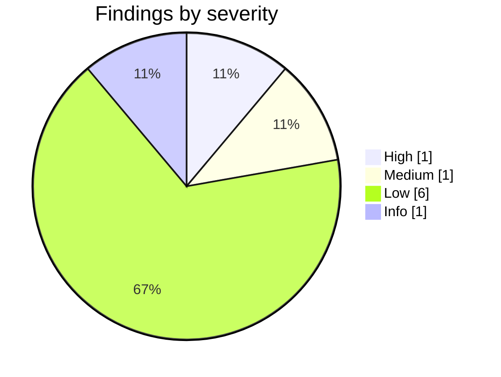
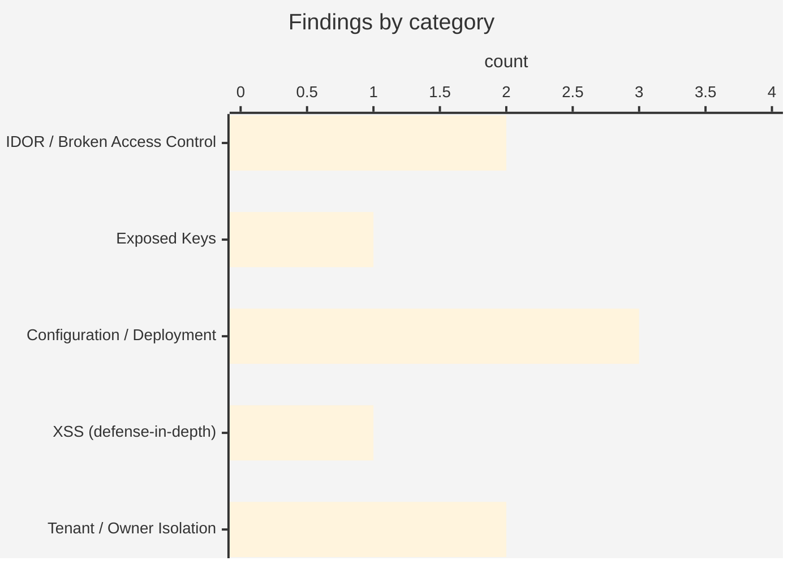

# Relatório de Auditoria de Segurança

> **Security Audit Report** — generated 2026-11-21

**Scope:** `romalopes/beachvolleyballhub_api` (Rails 8.1 API) and the consuming
`beachvolleyballhub` React/Vite SPA (including Capacitor Android/iOS bundles).

**Methodology note.** The five categories from the audit brief were mapped to this
stack: tenant isolation → Pundit scopes + `Current` + account-scoped queries;
browser permissions → controller concerns (`ContentAuthorization`) vs React role
gates; IDOR → every controller handler that loads a record by id; exposed keys →
`app/`, `lib/`, `config/`, `.env*`, `.kamal/secrets`, CI, and the built client
bundles; XSS → React sinks and Rails mailer/HTML templates. Findings below are
**verified in the code**; each cites `file:line`. Categories that do not apply are
stated rather than filled.

---

## Executive summary

| Severity | Count |
|---|---|
| <span style="background:#B91C1C;color:#fff;padding:1px 8px;border-radius:10px;font-size:12px;font-weight:600">Critical</span> | 0 |
| <span style="background:#EA580C;color:#fff;padding:1px 8px;border-radius:10px;font-size:12px;font-weight:600">High</span> | 1 |
| <span style="background:#D97706;color:#fff;padding:1px 8px;border-radius:10px;font-size:12px;font-weight:600">Medium</span> | 1 |
| <span style="background:#2563EB;color:#fff;padding:1px 8px;border-radius:10px;font-size:12px;font-weight:600">Low</span> | 6 |
| <span style="background:#6B7280;color:#fff;padding:1px 8px;border-radius:10px;font-size:12px;font-weight:600">Info</span> | 1 |
| **Total** | **9** |





**Severity legend:** <span style="background:#B91C1C;color:#fff;padding:1px 8px;border-radius:10px;font-size:12px;font-weight:600">Critical</span> · <span style="background:#EA580C;color:#fff;padding:1px 8px;border-radius:10px;font-size:12px;font-weight:600">High</span> · <span style="background:#D97706;color:#fff;padding:1px 8px;border-radius:10px;font-size:12px;font-weight:600">Medium</span> · <span style="background:#2563EB;color:#fff;padding:1px 8px;border-radius:10px;font-size:12px;font-weight:600">Low</span> · <span style="background:#6B7280;color:#fff;padding:1px 8px;border-radius:10px;font-size:12px;font-weight:600">Info</span>

## Strong points (what is protected, with evidence)

- ✅ JSON API is public-by-default but every sensitive controller re-adds `require_authentication` (e.g. accounts, notifications, preferences, billing base, claims).  
  <sub>`app/controllers/api/v1/application_controller.rb:12`</sub>
- ✅ Pundit is installed app-wide; denials render 404 for `show?` (no existence disclosure) and 401/403 otherwise via one handler.  
  <sub>`app/controllers/application_controller.rb:19,32-43`</sub>
- ✅ Account reads are gated by `can_manage_account?` / `can_view_account?`; contact fields only returned to managers.  
  <sub>`app/controllers/api/v1/accounts_controller.rb:72-97,10`</sub>
- ✅ Notifications are hard-scoped to `current_account.notifications` — no id reaches another account.  
  <sub>`app/controllers/api/v1/notifications_controller.rb:56,19-45`</sub>
- ✅ Assessment listing uses `Assessment.visible_to(Current.user)` and show returns 404 for hidden rows.  
  <sub>`app/controllers/api/v1/assessments_controller.rb:56-57,83-84`</sub>
- ✅ Analyses use `policy_scope(Analysis)` + `authorize` on every mutating action; children are parent-scoped.  
  <sub>`app/controllers/api/v1/analyses_controller.rb:10,27-73`</sub>
- ✅ Organisation public read returns every permission flag `false` for anonymous callers; memberships expose only display_name/role/status (no contact data).  
  <sub>`app/controllers/api/v1/organisations_controller.rb:886-915; app/models/organisation_membership.rb:166`</sub>
- ✅ Admin surface is uniformly gated by `authorize_admin!` (AdminAreaPolicy, real-user based).  
  <sub>`app/controllers/api/v1/admin/*.rb`</sub>
- ✅ Stripe webhook verifies the signature against `request.raw_post` before processing — signature is the authentication.  
  <sub>`app/controllers/api/v1/webhooks/stripe_controller.rb:32-37`</sub>
- ✅ Password reset and signup use token-based lookup + Turnstile + rate limiting; signup is transactional and email-verification gated.  
  <sub>`app/controllers/api/v1/passwords_controller.rb:21; registrations_controller.rb:6-33`</sub>
- ✅ No XSS sinks in the SPA: no `dangerouslySetInnerHTML`; the one `innerHTML` assignment is static markup; contact mailer relies on auto-escaping ERB.  
  <sub>`src/main.tsx:76; app/views/contact_message_mailer/notification.html.erb:16-18`</sub>
- ✅ Backend search endpoints escape LIKE wildcards with `sanitize_sql_like` (accounts, analyses, player_claims).  
  <sub>`app/controllers/api/v1/accounts_controller.rb:21; analyses_controller.rb:17`</sub>
- ✅ No hard-coded server secrets in `app/`, `lib/`, `config/`; `.env*`, `.kamal/secrets` hold no raw credentials; `config/master.key` git-ignored.  
  <sub>`repo-wide grep 2026-11-21`</sub>
- ✅ Contact form is layered: honeypot, Turnstile, validation, persistence, then async delivery — and returns a minimal, uniform response.  
  <sub>`app/controllers/api/v1/contact_messages_controller.rb:36-107`</sub>

## Weak points (central risks)

- ❌ **Unauthenticated write surface (SEC-01):** the `drill_skills` endpoint is reachable anonymously and lets anyone mutate catalogue joins.
- ❌ **Public browser key without proven GCP restrictions (SEC-02):** the Maps Embed key ships in every client bundle.
- ⚠️ **Environment-dependent hardening (SEC-04, SEC-05, SEC-09):** CORS localhost entries, `force_ssl`, the secure cookie flag and the test-access gate all key off env vars that a misconfigured deploy can leave open.

## Detailed findings

| ID | Severity | Category | File:line |
|---|---|---|---|
| SEC-01 | <span style="background:#EA580C;color:#fff;padding:1px 8px;border-radius:10px;font-size:12px;font-weight:600">High</span> | IDOR / Broken Access Control | `drill_skills_controller.rb:1-49` |
| SEC-02 | <span style="background:#D97706;color:#fff;padding:1px 8px;border-radius:10px;font-size:12px;font-weight:600">Medium</span> | Exposed Keys | `LocationMap.tsx:33` |
| SEC-03 | <span style="background:#2563EB;color:#fff;padding:1px 8px;border-radius:10px;font-size:12px;font-weight:600">Low</span> | IDOR / Broken Access Control | `accept_invitations_controller.rb:32-33` |
| SEC-04 | <span style="background:#2563EB;color:#fff;padding:1px 8px;border-radius:10px;font-size:12px;font-weight:600">Low</span> | Configuration / Deployment | `cors.rb:12-16` |
| SEC-05 | <span style="background:#2563EB;color:#fff;padding:1px 8px;border-radius:10px;font-size:12px;font-weight:600">Low</span> | Configuration / Deployment | `production.rb:29-31` |
| SEC-06 | <span style="background:#2563EB;color:#fff;padding:1px 8px;border-radius:10px;font-size:12px;font-weight:600">Low</span> | XSS (defense-in-depth) | `api.ts:56-69` |
| SEC-07 | <span style="background:#2563EB;color:#fff;padding:1px 8px;border-radius:10px;font-size:12px;font-weight:600">Low</span> | Tenant / Owner Isolation | `skills_controller.rb:4-14` |
| SEC-08 | <span style="background:#2563EB;color:#fff;padding:1px 8px;border-radius:10px;font-size:12px;font-weight:600">Low</span> | Tenant / Owner Isolation | `groups_controller.rb:41-44` |
| SEC-09 | <span style="background:#6B7280;color:#fff;padding:1px 8px;border-radius:10px;font-size:12px;font-weight:600">Info</span> | Configuration / Deployment | `test_access.rb:9-11` |

### SEC-01 — <span style="background:#EA580C;color:#fff;padding:1px 8px;border-radius:10px;font-size:12px;font-weight:600">High</span> — DrillSkills API is unauthenticated and has no authorization

- **Category:** IDOR / Broken Access Control
- **Location:** `beachvolleyballhub_api/app/controllers/api/v1/drill_skills_controller.rb` lines 1-49, 4, 6-36, 40-44
- **Exploitability conditions:** None — live route, exploitable anonymously.

**Evidence**

```
class DrillSkillsController < ApplicationController
  before_action :set_drill_skill, only: [ :show, :update, :destroy ]
  def index
    @drill_skills = DrillSkill.includes(:drill, :skill).all   # every row, anonymous
  end
  def create
    @drill_skill = DrillSkill.new(drill_skill_params)          # no auth, no policy
  end
  # update / destroy: no auth, no policy
end
```

**Why it is exploitable / risky**

`Api::V1::ApplicationController` skips `require_authentication` (the JSON API is
public by default); this controller adds only a `set_drill_skill` loader — no
authentication, no Pundit `authorize`, no gate. The route `resources :drill_skills`
(config/routes.rb:148) exposes `GET/POST/PATCH/PUT/DELETE /api/v1/drill_skills(/:id)`
to the internet.

**Impact**

Anonymous integrity tampering of catalogue data: anyone can list, create, mutate
and delete drill↔skill rows (detaching skills from drills across the catalogue).

**Suggested fix**

Add `before_action :require_authentication`, gate writes on a content-creator
concern (`require_content_creator!`) and `authorize` the affected Drill/Skill via
`DrillPolicy`/`SkillPolicy`; restrict reads to published content or managers. If the
endpoint is unused, remove `resources :drill_skills` from the routes.

### SEC-02 — <span style="background:#D97706;color:#fff;padding:1px 8px;border-radius:10px;font-size:12px;font-weight:600">Medium</span> — Google Maps Embed API key is shipped in every client bundle

- **Category:** Exposed Keys
- **Location:** `beachvolleyballhub/src/components/locations/LocationMap.tsx` lines 33, 37-45
- **Exploitability conditions:** Browser key — exposure is inherent; risk depends on GCP restrictions.

**Evidence**

```
const apiKey = import.meta.env.VITE_GOOGLE_MAPS_EMBED_API_KEY?.trim();
const url = new URL("https://www.google.com/maps/embed/v1/place");
url.searchParams.set("key", apiKey); // baked into dist/ + android/ + ios/
```

**Why it is exploitable / risky**

`VITE_*` variables are inlined into the client bundle at build time. The key
`AIzaSy…75bTw` is present in the served web bundle (`dist/assets/*.js`) and in the
Capacitor mobile bundles (`android/app/src/main/assets/public/assets/*.js`,
`ios/App/App/public/assets/*.js`). Google Maps *Embed* keys are browser keys and are
public by design, but only stay safe when restricted in GCP to the authorised HTTP
referrers / app bundle IDs and to the "Maps Embed API" only.

**Impact**

If unrestricted, any third party can embed the key on their own site and drain the
project's Maps quota and billable usage. The key ships with every app-store download.

**Suggested fix**

In Google Cloud Console restrict the key to the production HTTP referrers
(`https://beachvolleyballhub.com/*`, the Workers domain) plus the Android package
name / SHA-1 and iOS bundle ID, and to the "Maps Embed API" only. Rotate the key and
add a quota/budget alert. Keep it out of any committed mobile assets.

### SEC-03 — <span style="background:#2563EB;color:#fff;padding:1px 8px;border-radius:10px;font-size:12px;font-weight:600">Low</span> — AcceptInvitationsController#update resolves invitations by raw id (unrouted dead code)

- **Category:** IDOR / Broken Access Control
- **Location:** `beachvolleyballhub_api/app/controllers/accept_invitations_controller.rb` lines 32-33, 60-72
- **Exploitability conditions:** Not routed — latent only.

**Evidence**

```
def update
  @invitation = AccountInvitation.find(params[:id])   # no token check
  @invitation.user.update!(password_digest: BCrypt::Password.create(params[:password]), ...)
```

**Why it is exploitable / risky**

The action loads an `AccountInvitation` by numeric id and, on success, resets that
user's password and logs them in, with no proof the caller holds the invitation token
— a textbook account-takeover IDOR. It is **not exploitable today**: no
`accept-invitation` route is mounted (verified with `rails routes`) and the code also
references removed APIs (`is_verified`, `login`, `onboarding_path`).

**Impact**

Latent only — if routed, any visitor could take over any account by guessing an invitation id.

**Suggested fix**

Delete the dead controller/views, or resolve by `token_digest` (as `edit` does) before allowing any password change.

### SEC-04 — <span style="background:#2563EB;color:#fff;padding:1px 8px;border-radius:10px;font-size:12px;font-weight:600">Low</span> — CORS allow-list appends localhost and private-IP origins unconditionally

- **Category:** Configuration / Deployment
- **Location:** `beachvolleyballhub_api/config/initializers/cors.rb` lines 12-16, 18-26
- **Exploitability conditions:** Requires the browser to issue a cross-origin request from a localhost/LAN origin.

**Evidence**

```
if Rails.env.development?
  allowed_origins.concat([ "http://localhost:5174", "http://localhost:3001" ])
end
# ... but these are appended OUTSIDE the development guard:
allowed_origins << "http://localhost:5174"
allowed_origins << "http://192.168.1.25:5174"
allowed_origins << "http://192.168.1.105:5174"   # + several more LAN IPs
```

**Why it is exploitable / risky**

Development origins and hard-coded LAN IPs are appended to the allow-list regardless
of `Rails.env`, so the production API accepts browser requests from `http://localhost`
and specific private IPs. `credentials` is not enabled, so cross-origin cookies are
not sent, which blunts the risk — but the production origin allow-list should be the
deployed frontends only.

**Impact**

Weakens the origin allow-list; exposes the API to requests originating from a victim's own localhost/LAN (e.g. a malicious local app).

**Suggested fix**

Move the localhost/LAN entries inside the `Rails.env.development?` block and keep only real deployed origins (plus the Workers preview regex) in production.

### SEC-05 — <span style="background:#2563EB;color:#fff;padding:1px 8px;border-radius:10px;font-size:12px;font-weight:600">Low</span> — TLS enforcement and secure cookies depend on BEHIND_HTTPS_PROXY

- **Category:** Configuration / Deployment
- **Location:** `beachvolleyballhub_api/config/environments/production.rb` lines 29-31
- **Exploitability conditions:** Only exploitable if BEHIND_HTTPS_PROXY is unset in production.

**Evidence**

```
config.assume_ssl = ENV["BEHIND_HTTPS_PROXY"] == "true"
config.force_ssl  = ENV["BEHIND_HTTPS_PROXY"] == "true"
```

**Why it is exploitable / risky**

`force_ssl` (redirect + `secure` cookies) is enabled only when `BEHIND_HTTPS_PROXY`
is exactly `"true"`. The session cookie is also written without an explicit `secure`
flag (`cookies.signed.permanent[:session_id] = { httponly: true, same_site: :lax }`).
If the env var is missing/misspelled in a deployment, cookies can travel over plain
HTTP and no HTTP→HTTPS redirect happens.

**Impact**

Session confidentiality could be undermined by a misconfiguration (cookie sent over HTTP, no HSTS/redirect).

**Suggested fix**

Set `config.force_ssl = true` unconditionally in production and add `secure: true` to the session cookie (or rely on a documented, validated deploy profile that fails fast when the proxy flag is absent).

### SEC-06 — <span style="background:#2563EB;color:#fff;padding:1px 8px;border-radius:10px;font-size:12px;font-weight:600">Low</span> — Bearer auth token persisted in localStorage

- **Category:** XSS (defense-in-depth)
- **Location:** `beachvolleyballhub/src/api.ts` lines 56-69, 184-186
- **Exploitability conditions:** Defense-in-depth — no current XSS sink.

**Evidence**

```
const TOKEN_KEY = "bvb_api_token";
export function setToken(token) { if (token) localStorage.setItem(TOKEN_KEY, token); }
// request(): if (token) headers["Authorization"] = `Bearer ${token}`;
```

**Why it is exploitable / risky**

The cross-origin API bearer token is stored in `localStorage`, which is readable by
any JavaScript running on the origin. There is currently **no verified XSS sink** (see
the strong points), so this is not directly exploitable — but it removes the
HttpOnly-cookie safety net if a sink is ever introduced (a dependency, a future
`dangerouslySetInnerHTML`, a poisoned third-party script).

**Impact**

In combination with any future XSS, the bearer token is exfiltratable in one line, enabling full account takeover.

**Suggested fix**

Prefer an HttpOnly, Secure, SameSite cookie for the session (the backend already sets one) and keep bearer tokens out of web storage, or shorten token lifetime and bind tokens to a rotating refresh flow.

### SEC-07 — <span style="background:#2563EB;color:#fff;padding:1px 8px;border-radius:10px;font-size:12px;font-weight:600">Low</span> — Server-rendered Skills HTML view exposes non-published skills

- **Category:** Tenant / Owner Isolation
- **Location:** `beachvolleyballhub_api/app/controllers/skills_controller.rb` lines 4-14
- **Exploitability conditions:** HTML routes only; metadata exposure, no secrets.

**Evidence**

```
def index
  @skills = Skill.includes(:discipline).order(:title)   # no published/shared filter
end
def show
  @skill = Skill...find_by(slug: params[:id])
  @related_drills = @skill.drills...order(:title)       # no visibility check
end
```

**Why it is exploitable / risky**

The API `SkillPolicy#show?` restricts skills to `published_and_shared? || manager?`,
but this legacy server-rendered controller (route `get "skills"`, `get "skills/:id"`)
lists/serves every skill, including drafts, to anonymous visitors. The sibling
`drills_controller` *does* apply the published+shared gate, so the two differ.

**Impact**

Low: unpublished catalogue metadata (skill titles/descriptions and related drill titles) is readable anonymously via the HTML routes.

**Suggested fix**

Apply `Skill.published_and_shared` (and the same visibility predicate used by `SkillPolicy`) in the HTML controller, or retire the legacy HTML routes if the SPA is the only product surface.

### SEC-08 — <span style="background:#2563EB;color:#fff;padding:1px 8px;border-radius:10px;font-size:12px;font-weight:600">Low</span> — Groups search does not escape SQL LIKE wildcards

- **Category:** Tenant / Owner Isolation
- **Location:** `beachvolleyballhub_api/app/controllers/api/v1/groups_controller.rb` lines 41-44
- **Exploitability conditions:** Authenticated caller; scoped to groups they can already see.

**Evidence**

```
if params[:q].present?
  term = "%#{params[:q]}%"
  groups = groups.where("groups.name ILIKE :t OR groups.description ILIKE :t", t: term)
end
```

**Why it is exploitable / risky**

The value is bound (so it is **not** SQL injection), but user-supplied `%` and `_`
are not escaped with `sanitize_sql_like`, unlike `AccountsController#search` and
`AnalysesController#index`. A query of `%%%%` forces a full-scan LIKE and arbitrary
wildcards change matching semantics.

**Impact**

Low: wildcard pattern injection (behavioural noise / minor DoS on large tables) within the caller's already-scoped group set.

**Suggested fix**

Use `ActiveRecord::Base.sanitize_sql_like(params[:q])` before wrapping in `%…%`, matching the other controllers.

### SEC-09 — <span style="background:#6B7280;color:#fff;padding:1px 8px;border-radius:10px;font-size:12px;font-weight:600">Info</span> — Private test-access gate is open when TEST_ACCESS_PASSWORD is unset

- **Category:** Configuration / Deployment
- **Location:** `beachvolleyballhub_api/app/controllers/concerns/test_access.rb` lines 9-11, 30-31
- **Exploitability conditions:** Deployment configuration only.

**Evidence**

```
# When TEST_ACCESS_PASSWORD is unset the gate is open (disabled) so local dev and CI are unaffected.
def require_test_access
  return unless TestAccessToken.enabled?   # enabled? == TEST_ACCESS_PASSWORD present
end
```

**Why it is exploitable / risky**

This extra gate is intentionally open when the password is unset (local/CI). It is
not the primary authentication (user auth still applies), but a production deployment
that forgets the variable silently loses this layer.

**Impact**

Informational: reduces one defense layer if misconfigured in production.

**Suggested fix**

Document TEST_ACCESS_PASSWORD as an explicit production deploy requirement; optionally log a boot warning when Rails.env.production? and it is unset.

## Prioritized recommendations

**P1 — Immediate**
1. **SEC-01:** authenticate + authorize `DrillSkillsController` (or remove the route). This is the only anonymously reachable write surface.

**P2 — This sprint**
2. **SEC-02:** confirm and enforce Google Maps Embed key restrictions (HTTP referrer + Android/iOS bundle id + API restriction), rotating the key and adding a quota alert.
3. **SEC-05:** make `force_ssl` unconditional in production and set `secure: true` on the session cookie.
4. **SEC-04:** move localhost/LAN origins inside the development-only block.

**P3 — Hardening**
5. **SEC-07:** apply the published/visibility predicate to the legacy Skills HTML controller (or retire it).
6. **SEC-08:** escape LIKE wildcards in `GroupsController#search`.
7. **SEC-06:** move the bearer token off `localStorage` toward the HttpOnly session cookie.
8. **SEC-09:** document `TEST_ACCESS_PASSWORD` as a required production variable.

---

## ISSUES PARA O GITHUB

--- ISSUE 1 ---

**Título:** `[Segurança] DrillSkills API is unauthenticated and has no authorization`

**Labels:** `security`, `severity:high`

### Descrição do problema

`Api::V1::ApplicationController` skips `require_authentication` (the JSON API is
public by default); this controller adds only a `set_drill_skill` loader — no
authentication, no Pundit `authorize`, no gate. The route `resources :drill_skills`
(config/routes.rb:148) exposes `GET/POST/PATCH/PUT/DELETE /api/v1/drill_skills(/:id)`
to the internet.

### Evidência

`beachvolleyballhub_api/app/controllers/api/v1/drill_skills_controller.rb` — linhas 1-49, 4, 6-36, 40-44

```
class DrillSkillsController < ApplicationController
  before_action :set_drill_skill, only: [ :show, :update, :destroy ]
  def index
    @drill_skills = DrillSkill.includes(:drill, :skill).all   # every row, anonymous
  end
  def create
    @drill_skill = DrillSkill.new(drill_skill_params)          # no auth, no policy
  end
  # update / destroy: no auth, no policy
end
```

### Impacto

Anonymous integrity tampering of catalogue data: anyone can list, create, mutate
and delete drill↔skill rows (detaching skills from drills across the catalogue).

### Sugestão de correção

Add `before_action :require_authentication`, gate writes on a content-creator
concern (`require_content_creator!`) and `authorize` the affected Drill/Skill via
`DrillPolicy`/`SkillPolicy`; restrict reads to published content or managers. If the
endpoint is unused, remove `resources :drill_skills` from the routes.

### Critérios de aceite

- [ ] A falha descrita não é mais reproduzível.
- [ ] Teste automatizado cobre o cenário (positivo e negativo).
- [ ] Revisão de código confirma que a correção não abre nova superfície.

--- FIM ISSUE 1 ---

--- ISSUE 2 ---

**Título:** `[Segurança] Google Maps Embed API key is shipped in every client bundle`

**Labels:** `security`, `severity:medium`

### Descrição do problema

`VITE_*` variables are inlined into the client bundle at build time. The key
`AIzaSy…75bTw` is present in the served web bundle (`dist/assets/*.js`) and in the
Capacitor mobile bundles (`android/app/src/main/assets/public/assets/*.js`,
`ios/App/App/public/assets/*.js`). Google Maps *Embed* keys are browser keys and are
public by design, but only stay safe when restricted in GCP to the authorised HTTP
referrers / app bundle IDs and to the "Maps Embed API" only.

### Evidência

`beachvolleyballhub/src/components/locations/LocationMap.tsx` — linhas 33, 37-45

```
const apiKey = import.meta.env.VITE_GOOGLE_MAPS_EMBED_API_KEY?.trim();
const url = new URL("https://www.google.com/maps/embed/v1/place");
url.searchParams.set("key", apiKey); // baked into dist/ + android/ + ios/
```

### Impacto

If unrestricted, any third party can embed the key on their own site and drain the
project's Maps quota and billable usage. The key ships with every app-store download.

### Sugestão de correção

In Google Cloud Console restrict the key to the production HTTP referrers
(`https://beachvolleyballhub.com/*`, the Workers domain) plus the Android package
name / SHA-1 and iOS bundle ID, and to the "Maps Embed API" only. Rotate the key and
add a quota/budget alert. Keep it out of any committed mobile assets.

### Critérios de aceite

- [ ] A falha descrita não é mais reproduzível.
- [ ] Teste automatizado cobre o cenário (positivo e negativo).
- [ ] Revisão de código confirma que a correção não abre nova superfície.

--- FIM ISSUE 2 ---

--- ISSUE 3 ---

**Título:** `[Segurança] CORS allow-list appends localhost and private-IP origins unconditionally`

**Labels:** `security`, `severity:low`

### Descrição do problema

Development origins and hard-coded LAN IPs are appended to the allow-list regardless
of `Rails.env`, so the production API accepts browser requests from `http://localhost`
and specific private IPs. `credentials` is not enabled, so cross-origin cookies are
not sent, which blunts the risk — but the production origin allow-list should be the
deployed frontends only.

### Evidência

`beachvolleyballhub_api/config/initializers/cors.rb` — linhas 12-16, 18-26

```
if Rails.env.development?
  allowed_origins.concat([ "http://localhost:5174", "http://localhost:3001" ])
end
# ... but these are appended OUTSIDE the development guard:
allowed_origins << "http://localhost:5174"
allowed_origins << "http://192.168.1.25:5174"
allowed_origins << "http://192.168.1.105:5174"   # + several more LAN IPs
```

### Impacto

Weakens the origin allow-list; exposes the API to requests originating from a victim's own localhost/LAN (e.g. a malicious local app).

### Sugestão de correção

Move the localhost/LAN entries inside the `Rails.env.development?` block and keep only real deployed origins (plus the Workers preview regex) in production.

### Critérios de aceite

- [ ] A falha descrita não é mais reproduzível.
- [ ] Teste automatizado cobre o cenário (positivo e negativo).
- [ ] Revisão de código confirma que a correção não abre nova superfície.

--- FIM ISSUE 3 ---

--- ISSUE 4 ---

**Título:** `[Segurança] TLS enforcement and secure cookies depend on BEHIND_HTTPS_PROXY`

**Labels:** `security`, `severity:low`

### Descrição do problema

`force_ssl` (redirect + `secure` cookies) is enabled only when `BEHIND_HTTPS_PROXY`
is exactly `"true"`. The session cookie is also written without an explicit `secure`
flag (`cookies.signed.permanent[:session_id] = { httponly: true, same_site: :lax }`).
If the env var is missing/misspelled in a deployment, cookies can travel over plain
HTTP and no HTTP→HTTPS redirect happens.

### Evidência

`beachvolleyballhub_api/config/environments/production.rb` — linhas 29-31

```
config.assume_ssl = ENV["BEHIND_HTTPS_PROXY"] == "true"
config.force_ssl  = ENV["BEHIND_HTTPS_PROXY"] == "true"
```

### Impacto

Session confidentiality could be undermined by a misconfiguration (cookie sent over HTTP, no HSTS/redirect).

### Sugestão de correção

Set `config.force_ssl = true` unconditionally in production and add `secure: true` to the session cookie (or rely on a documented, validated deploy profile that fails fast when the proxy flag is absent).

### Critérios de aceite

- [ ] A falha descrita não é mais reproduzível.
- [ ] Teste automatizado cobre o cenário (positivo e negativo).
- [ ] Revisão de código confirma que a correção não abre nova superfície.

--- FIM ISSUE 4 ---

--- ISSUE 5 ---

**Título:** `[Segurança] Server-rendered Skills HTML view exposes non-published skills`

**Labels:** `security`, `severity:low`

### Descrição do problema

The API `SkillPolicy#show?` restricts skills to `published_and_shared? || manager?`,
but this legacy server-rendered controller (route `get "skills"`, `get "skills/:id"`)
lists/serves every skill, including drafts, to anonymous visitors. The sibling
`drills_controller` *does* apply the published+shared gate, so the two differ.

### Evidência

`beachvolleyballhub_api/app/controllers/skills_controller.rb` — linhas 4-14

```
def index
  @skills = Skill.includes(:discipline).order(:title)   # no published/shared filter
end
def show
  @skill = Skill...find_by(slug: params[:id])
  @related_drills = @skill.drills...order(:title)       # no visibility check
end
```

### Impacto

Low: unpublished catalogue metadata (skill titles/descriptions and related drill titles) is readable anonymously via the HTML routes.

### Sugestão de correção

Apply `Skill.published_and_shared` (and the same visibility predicate used by `SkillPolicy`) in the HTML controller, or retire the legacy HTML routes if the SPA is the only product surface.

### Critérios de aceite

- [ ] A falha descrita não é mais reproduzível.
- [ ] Teste automatizado cobre o cenário (positivo e negativo).
- [ ] Revisão de código confirma que a correção não abre nova superfície.

--- FIM ISSUE 5 ---

